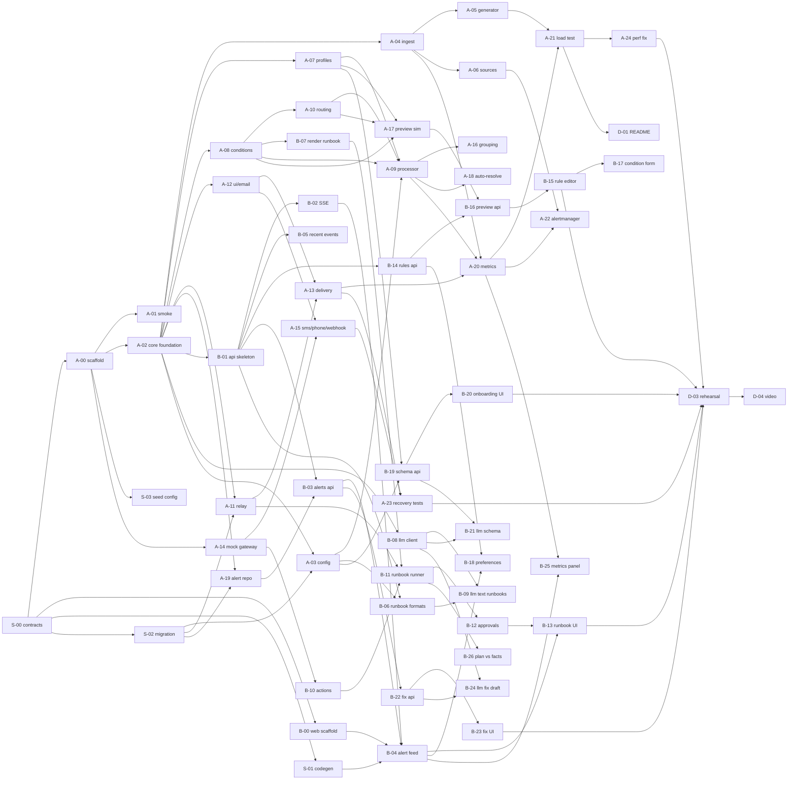

# Implementation plan — Flexible Alerting & Notification Service

Sources: `docs/task.md` (brief, currently reconstructed), `docs/plan.md` (architecture, Polish),
`docs/glossary.md` (names), `contracts/` (frozen interfaces), `OWNERSHIP.md` (who edits what),
`CLAUDE.md` (conventions, routing policy, definition of done).

## 0. Assumptions and open questions

| # | Question | What we do now |
|---|---|---|
| 1 | The official brief (`docs/task.md`) was not in the repo. | **ASSUMPTION:** requirements, judging criteria and fixtures are reconstructed from `docs/plan.md`. First thing in hour 0: paste the brief, diff it against `docs/task.md`, replace fixtures, add tasks for anything untraced (orchestrator, 15 min). |
| 2 | Who takes which track? | **ASSUMPTION:** Igor = track A and runs the orchestrator session; teammate = track B. |
| 3 | Hardware for the local LLM. | **ASSUMPTION:** Ollama with `qwen2.5:7b-instruct` (structured output via `format: <json schema>`); fall back to `qwen2.5:3b-instruct` if a runbook normalization takes > 20 s. Measured in task B-08 in hour 1. |
| 4 | Reusing Dynamic-Monitoring needs a `FakeSource` flag added in Go in another repo. | **ASSUMPTION:** we copy only its Prometheus/Grafana/Alertmanager config into `deploy/`; the "real Prometheus alert" is a rule on our own metric `mock_gateway_up == 0`. The FakeSource exporter is a stretch goal inside A-22. |
| 5 | MailHog or Mailpit? | **ASSUMPTION:** Mailpit (maintained, `GET /api/v1/messages` for the smoke test). |
| 6 | Semantics of the `ui` channel vs. the live feed. | **ASSUMPTION:** every alert appears in the live feed (processor publishes `alert.created`); the `ui` channel produces a `notification` toast for the team and is measured like other channels. |
| 7 | Does anyone know Go? | **ASSUMPTION:** no; a Go processor is out of scope. Performance fixes stay in Python (A-24). |

## 1. Critical path and hour 0–1

**Critical path (track A):** S-00 → A-00 → A-02 → A-04 → A-07 + A-08 → A-09 → A-11 → A-12 + A-13
→ **7 h** → A-10 + A-16 + A-17 → **11 h** first measurement (A-21) → A-24 → **14 h** freeze → D-03 → D-04.
**Critical path (track B):** B-00 + B-01 → B-04 → B-07 → B-10 → B-11 → B-12 → B-13 → **14 h** runbook with approval.
The two meet at A-17 → B-16 (rule preview) and at A-19 → B-03 (alerts API).

### Hour 0–1, Person A (backend, orchestrator session)

| Time | Action |
|---|---|
| 0:00–0:15 | Paste the official brief into `docs/task.md`; diff it against the reconstruction; update fixtures and the traceability table if needed (open question 1). |
| 0:15–0:35 | Review `contracts/` with Person B, especially `config.py`, `alerts.py`, `storage.md`. Fix anything wrong now: changes are free until 1:00. |
| 0:20 | Dispatch **A-00** (`scaffolder`, haiku): pyproject, compose skeleton, Dockerfile, Makefile. In parallel, write **S-02** (initial migration) in the orchestrator session. |
| 0:40 | Once A-00 is green: start **A-02** in the orchestrator session (opus: `StreamConsumer` failure semantics) and dispatch **A-01** (`test-engineer`) for `scripts/smoke_test.py` with `--gate 3h` checks. Then dispatch **A-04** as soon as A-02's settings/connections part is committed. |
| 1:00 | Commit `feat(contracts): freeze v1` together with Person B. From now on, the contract change rule applies. |

### Hour 0–1, Person B (UI, runbooks, LLM)

| Time | Action |
|---|---|
| 0:00–0:15 | `ollama pull qwen2.5:7b-instruct`; run the model check from B-08 step 1 (structured output on `fixtures/runbooks/pricing-stale-feed.txt`, record latency). |
| 0:15–0:35 | Contract review with Person A, focusing on `api.py`, `sse.py`, `runbooks.py` and the `openapi.yaml` paths. |
| 0:35 | Dispatch **S-01** (contract generator and TypeScript types) and **B-00** (web scaffold) in parallel; they have no file overlap. |
| 0:50 | Dispatch **S-03** (seed `config/` from examples and fixtures) once A-00 has created `config/`. |
| 1:00 | Contract freeze, as above. Then **B-01** (api service skeleton). |

## 2. Task index

Tiers follow the routing policy in `CLAUDE.md`. Cut priority: `keep` = never cut; `cut-1` is cut first.

| ID | Title | Gate | Depends on | Tier | Agent | Cut |
|---|---|---|---|---|---|---|
| S-00 | Freeze v1 contracts | 1 h | — | opus | orchestrator | keep |
| S-01 | Generate JSON Schema, OpenAPI components and TS types from contracts | 3 h | S-00 | sonnet | backend-engineer | keep |
| S-02 | Write initial Postgres migration from `contracts/storage.md` | 3 h | S-00 | opus | orchestrator | keep |
| S-03 | Seed `config/` with the demo configuration | 3 h | S-00, A-00 | haiku | scaffolder | keep |
| A-00 | Scaffold Python workspace, compose stack and Makefile | 3 h | S-00 | haiku | scaffolder | keep |
| A-01 | Implement `scripts/smoke_test.py` with per-gate checks | 3 h → 14 h | A-00 | sonnet | test-engineer | keep |
| A-02 | Build `alerting_core` foundation (settings, logging, durations, connections, metrics, stream consumer) | 3 h | A-00 | opus | orchestrator | keep |
| A-03 | Load and hot-reload configuration (YAML → Postgres → registry, `config.changed`) | 7 h | A-02, S-02 | sonnet | backend-engineer | keep |
| A-04 | Build the ingest service with the source registry and webhook source | 3 h | A-02 | sonnet | backend-engineer | keep |
| A-05 | Build the event generator | 3 h | A-04 | sonnet | backend-engineer | keep |
| A-06 | Add Alertmanager and log-tail source plugins | 7 h | A-04 | sonnet | plugin-author | keep |
| A-07 | Map events through schema profiles (incl. generic profile, unknown-schema samples) | 7 h | A-02 | sonnet | backend-engineer | keep |
| A-08 | Evaluate conditions, resolve field paths, render templates | 7 h | A-02 | sonnet | backend-engineer | keep |
| A-09 | Build the processor worker (dedup, alert + outbox transaction) | 7 h | A-03, A-07, A-08, A-10 | opus | orchestrator | keep |
| A-10 | Resolve recipients and channels (on-call, channel preferences, working hours, throttle) | 7 h | A-08 | sonnet | backend-engineer | keep |
| A-11 | Build the outbox relay | 7 h | A-02, S-02 | opus | orchestrator | keep |
| A-12 | Add channel registry with `ui` and `email` channels | 7 h | A-02 | sonnet | plugin-author | keep |
| A-13 | Build the delivery worker (retries, XAUTOCLAIM, DLQ, fallback, circuit breaker) | 7 h | A-11, A-12 | opus | orchestrator | keep |
| A-14 | Build the mock gateway service | 7 h | A-00 | sonnet | backend-engineer | keep |
| A-15 | Add `sms`, `phone` and `webhook` channels | 11 h | A-12, A-14 | sonnet | plugin-author | keep |
| A-16 | Implement group windows (buffer, flush, group summary alert) | 11 h | A-09 | opus | orchestrator | keep |
| A-17 | Implement pure rule preview simulation | 11 h | A-08, A-10, A-07 | sonnet | backend-engineer | keep |
| A-18 | Auto-resolve on resolution events and after silence | 14 h | A-09 | sonnet | backend-engineer | keep |
| A-19 | Provide alert repository queries and state transitions | 7 h | A-02, S-02 | sonnet | backend-engineer | keep |
| A-20 | Expose Prometheus metrics and build the Grafana dashboard | 11 h | A-04, A-09, A-13 | sonnet | backend-engineer | keep |
| A-21 | Run load-test scenarios and record results | 11 h → 14 h | A-05, A-20 | sonnet | backend-engineer | keep |
| A-22 | Wire real Prometheus + Alertmanager as a source | 14 h | A-06, A-20 | sonnet | scaffolder → backend-engineer | cut-5 |
| A-23 | Add integration tests for channel-down and worker-kill recovery | 14 h | A-13, A-15 | sonnet | test-engineer | keep |
| A-24 | Diagnose and fix bottlenecks after the first measurement | 14 h | A-21 | opus | orchestrator | keep |
| B-00 | Scaffold the web app (Vite, React, TS, Tailwind, team picker) | 3 h | S-00 | haiku | scaffolder | keep |
| B-01 | Build the api service skeleton (`/healthz`, `/config`, `/events/recent`) | 3 h | A-02 | sonnet | backend-engineer | keep |
| B-02 | Implement the SSE stream endpoint and `useEventStream` hook | 7 h | B-01 | sonnet | backend-engineer | keep |
| B-03 | Implement alerts API routes (list, detail, acknowledge, resolve) | 7 h | B-01, A-19 | sonnet | backend-engineer | keep |
| B-04 | Build `AlertFeed` and `AlertDetail` (audit, deliveries, group drill-down) | 7 h | B-00, S-01, B-02, B-03 | sonnet | frontend-engineer | keep |
| B-05 | Build `RecentEventsPanel` | 3 h | B-00, B-01 | sonnet | frontend-engineer | keep |
| B-06 | Add runbook-format plugins (yaml, markdown, text fallback) and runbook API | 11 h | B-01, A-03 | sonnet | plugin-author | keep |
| B-07 | Render runbooks for an alert | 7 h | A-08 | sonnet | backend-engineer | keep |
| B-08 | Build the LLM client (Ollama structured output, validation, cache, redaction) | 7 h | A-02 | sonnet | backend-engineer | keep |
| B-09 | Normalize free-text runbooks with the LLM at save time | 14 h | B-06, B-08 | sonnet | plugin-author | cut-3 |
| B-10 | Add action registry and action plugins | 11 h | A-02, A-14 | sonnet | plugin-author | keep |
| B-11 | Build the runbook runner service | 14 h | B-07, B-10, A-11 | sonnet | backend-engineer | keep |
| B-12 | Implement approvals API and phone-simulator replies | 14 h | B-11 | sonnet | backend-engineer | keep |
| B-13 | Build `RunbookPanel`, `ApprovalQueue` and `PhoneSimulator` | 14 h | B-04, B-12 | sonnet | frontend-engineer | keep |
| B-14 | Implement rules API and config validation endpoint | 11 h | B-01, A-03 | sonnet | backend-engineer | keep |
| B-15 | Build `RuleEditor` (YAML with validation) and `RulePreviewPanel` | 11 h | B-14, B-16 | sonnet | frontend-engineer | keep |
| B-16 | Wire the rule preview endpoint | 11 h | A-17, B-14 | sonnet | backend-engineer | keep |
| B-17 | Build `RuleConditionForm` for simple conditions | 14 h | B-15 | sonnet | frontend-engineer | cut-4 |
| B-18 | Implement channel-preferences API and `ChannelPreferencesEditor` | 11 h | B-14, B-04 | sonnet | frontend-engineer | keep |
| B-19 | Implement schema-profile API (list, save, test) and unknown-schema inbox | 14 h | B-01, A-07, A-03 | sonnet | backend-engineer | keep |
| B-20 | Build `SchemaOnboarding` UI (inbox, mapping form, live test, save) | 16 h | B-19 | sonnet | frontend-engineer | keep |
| B-21 | Propose schema profiles with the LLM | 16 h | B-08, B-19 | sonnet | backend-engineer | cut-2 |
| B-22 | Implement fix-proposals API | 14 h | B-03, A-03 | sonnet | backend-engineer | keep |
| B-23 | Build `ProposeFixDialog` and `FixProposalReview` | 14 h | B-22, B-04 | sonnet | frontend-engineer | keep |
| B-24 | Draft fix proposals with the LLM | 16 h | B-08, B-22 | sonnet | backend-engineer | cut-2 |
| B-25 | Implement metrics summary endpoint and `MetricsPanel` | 14 h | A-20, B-04 | sonnet | frontend-engineer | keep |
| B-26 | Propose runbook revisions from audit (plan vs facts) | 16 h | B-11, B-08 | sonnet | backend-engineer | cut-1 |
| D-01 | Write README (quickstart, what is mocked, results, AI usage) | 16 h | A-21 | haiku | docs-writer | keep |
| D-02 | Write plugin how-to READMEs | 14 h | A-12, A-06, B-06, B-10 | haiku | docs-writer | keep |
| D-03 | Rehearse the demo and the "judges bring a schema and runbook" path | 16 h | all keep tasks | opus | orchestrator + both people | keep |
| D-04 | Record and submit the video | 18 h | D-03 | — | humans | keep |
| O-xx | Gate reviews at 3 h, 7 h, 11 h, 14 h, 16 h | each gate | gate tasks | opus | orchestrator + code-reviewer + verifier | keep |

## 3. Task details

Common to every task: definition of done from `CLAUDE.md` (tests, lint, `smoke_test.py` green at the
current gate, glossary names, no contract drift, `docs/CHANGELOG.md` line). Paths below are relative
to the repo root. Python tests live next to their code in `tests/` subdirectories.

### Shared (hour 0–1)

**S-00 Freeze v1 contracts** — opus, orchestrator. Files: `contracts/**`, `docs/glossary.md`.
- AC: both people reviewed `contracts/`; `feat(contracts): freeze v1` committed at 1:00; every example in `contracts/examples/` validates.
- Verify: `uv run python scripts/generate_contracts.py --check` (after S-01); before S-01: `uv run --with pydantic --with pyyaml python -c "import alerting_contracts"` from `contracts/`.

**S-01 Generate JSON Schema, OpenAPI components and TS types** — sonnet, backend-engineer. Files: `scripts/generate_contracts.py`, `contracts/schemas/`, `contracts/openapi.yaml` (components only), `web/src/api/schema.gen.ts` (does **not** touch `web/package.json`; runs `npx -y openapi-typescript@7`, so it can run in parallel with B-00).
- AC: the script rewrites `contracts/schemas/*.schema.json` and `components.schemas` from the Pydantic models, keeping `paths` byte-identical; fails when any `$ref` is unresolved; runs `npx openapi-typescript`; `--check` exits 1 when generated files differ; every config example validates against its JSON Schema.
- Verify: `uv run python scripts/generate_contracts.py && git diff --exit-code contracts/openapi.yaml` (no path changes) · `uv run python scripts/generate_contracts.py --check` · `cd web && npx tsc --noEmit`.

**S-02 Initial Postgres migration** — opus, orchestrator. Files: `deploy/postgres/migrations/0001_initial.sql`.
- AC: creates every table and index in `contracts/storage.md`; applied automatically by the postgres container on first start; re-running compose on an existing volume does not fail.
- Verify: `docker compose up -d postgres && docker compose exec postgres psql -U alerting -c '\dt'` lists 11 tables.

**S-03 Seed demo configuration** — haiku, scaffolder. Files: `config/**`, `loadtest/fixtures/` (symlink or copy of `contracts/fixtures/events`).
- AC: `config/` holds teams `rates`, `settlements`, `pricing`, `platform`; recipients `anna` + one per other team; channels `ui`, `email`, `sms`, `phone`, `slack-rates` (webhook); sources `rates-oms`, `settlements-engine`, `pricing-log`, `alertmanager`, `generic-webhook`; schema profiles `trade-rejected`, `workflow-failed`, `pricing-log`, `alertmanager`, `generic`; rules `rates-large-rejections`, `settlements-workflow-failed`, `pricing-stale-feed`, `platform-alertmanager`; runbooks in all three formats; actions `http-health-check`, `retry-workflow`, `restart-pricing-adapter` (approval required), `open-ticket`, `escalate`. Every file validates.
- Verify: `uv run python scripts/validate_config.py config/` (created by the agent: 20 lines, loads every YAML into its contract model) exits 0.

### Track A

**A-00 Scaffold Python workspace, compose stack and Makefile** — haiku, scaffolder. Files: `pyproject.toml`, `uv.lock`, `compose.yaml`, `deploy/python.Dockerfile`, `deploy/prometheus/`, `deploy/grafana/`, `Makefile`, `services/*/main.py` stubs, `.env.example` (only new keys).
- AC: one image for all Python services; `compose.yaml` has postgres 16, redis 7, mailpit, ollama, prometheus, grafana, ingest, processor, outbox-relay, delivery, mock-gateway, api, runbook-runner, web. Every Python service starts and answers `GET /healthz` (workers expose it on their metrics port). `make up`, `make test`, `make lint`, `make smoke`, `make loadtest` exist. Ruff and pytest are configured in `pyproject.toml`.
- Verify: `docker compose up -d --build && docker compose ps` (all `running`/`healthy`) · `make lint` · `make test` (0 tests ok).

**A-01 Implement `scripts/smoke_test.py`** — sonnet, test-engineer. Files: `scripts/smoke_test.py`.
- AC: `--gate {3h,7h,11h,14h}` enables cumulative checks; exits non-zero with a one-line reason per failed check. Checks:
  - **3h:** each service's `/healthz`; POST the three fixtures (two webhooks, plus one log line appended to the tailed file once A-06 is done); `GET /api/v1/events/recent` shows them.
  - **7h:** an alert appears in `GET /api/v1/alerts` for each fixture, titled `Rejected EUR 25000000 — LIMIT_BREACH`; the Mailpit API has the email; delivery status is `delivered`.
  - **11h:** sending the rates event 5× gives one alert with `count == 5`; `PUT` a changed rule changes the next alert's title with no restart; Anna's SMS lands in `phone-simulator/messages`.
  - **14h:** the alert detail has a rendered runbook with `wf-settle-20261120-0042` filled in; an approval request appears for the escalate step; `POST /api/v1/phone-simulator/replies` with `APPROVE <code>` makes the action run `succeeded`; an audit entry exists.
- Verify: `uv run python scripts/smoke_test.py --gate 3h` (expected to fail clearly on missing services before A-04).

**A-02 Build `alerting_core` foundation** — opus, orchestrator. Files: `packages/alerting_core/alerting_core/{settings,logging,durations,connections,metrics,streams}.py` and tests.
- AC: `Settings` from env (pydantic-settings); JSON logs with `event`, `service`, `alert_id`, `rule_id`; `parse_duration("5m") == 300.0`; asyncpg pool and redis client factories; Prometheus registry helpers; `StreamConsumer` (creates the group, `XREADGROUP COUNT/BLOCK`, handler per batch, `XACK` after success, `XAUTOCLAIM` of entries idle > 30 s, poison entries to a DLQ after 5 deliveries) reused by processor, delivery and runbook runner.
- Verify: `uv run pytest packages/alerting_core/tests/test_durations.py packages/alerting_core/tests/test_streams.py -q` (stream tests use a real Redis via `docker compose up -d redis`).

**A-03 Load and hot-reload configuration** — sonnet, backend-engineer. Files: `packages/alerting_core/alerting_core/config/` and tests.
- AC: `load_config_directory(path)` validates every YAML with its contract model and reports file + path errors; on startup files are upserted into `config_documents` (a file wins over the DB only if its version is newer); `ConfigRegistry` holds typed snapshots and reloads on pub/sub `config.changed`; `save_config_document(kind, document, actor)` serializes canonical YAML, bumps `version`, writes the DB, publishes `config.changed`; file watcher (`watchfiles`) on `config/` calls the same path.
- Verify: `uv run pytest packages/alerting_core/tests/config -q` · manual: edit `config/rules/rates-large-rejections.yaml`, see `config_reloaded` in `docker compose logs processor`.

**A-04 Build the ingest service** — sonnet, backend-engineer. Files: `services/ingest/`, `plugins/sources/{base,registry,webhook}.py` and tests.
- AC: `POST /api/v1/ingest/{source_id}` and `/batch` per `openapi.yaml`; unknown source → 404; non-JSON body → 422; envelope with ULID `event_id`; `X-Sent-At` → `sent_at`; idempotency with `SET NX` (duplicate → counted in `duplicate_count`, not added); `XADD` via pipeline for batches; 202 in < 5 ms p50 locally; uvicorn with `--workers ${INGEST_WORKERS:-2}` and uvloop.
- Verify: `uv run pytest services/ingest/tests -q` · `curl -s -XPOST localhost:8001/api/v1/ingest/rates-oms -H 'content-type: application/json' -d @contracts/fixtures/events/rates_trade_rejected.json` → 202 · `docker compose exec redis redis-cli XLEN events`.

**A-05 Build the event generator** — sonnet, backend-engineer. Files: `loadtest/generator.py`, `loadtest/README.md`.
- AC: CLI `--rate`, `--duration`, `--duplicate-ratio`, `--unknown-ratio`, `--mix rates:1,settlements:1,pricing:1`, `--batch-size`; uses httpx with HTTP/1.1 keep-alive and multiple async workers; sets `X-Sent-At`; varies `tradeId`, `workflowId` and `instrument`; also appends pricing log lines to the tailed file; prints achieved msg/s.
- Verify: `uv run python loadtest/generator.py --rate 200 --duration 10` reports ≈ 2000 sent, and `XLEN events` grows by the same amount.

**A-06 Add Alertmanager and log-tail source plugins** — sonnet, plugin-author. Files: `plugins/sources/{alertmanager,log_tail}.py`, tests, `plugins/sources/README.md`.
- AC: an Alertmanager batch becomes one event per `alerts[]` item, with top-level `status` copied in. `log_tail` follows a file (survives rotation), parses `regex`/`json` lines and puts `raw_line` into the payload. It runs as a background task inside ingest for every enabled `log_tail` source. A parse failure goes to `events-dlq` with the raw line.
- Verify: `uv run pytest plugins/sources/tests -q` · `cat contracts/fixtures/events/pricing_engine.log >> data/logs/pricing_engine.log` → 4 new entries in `events`.

**A-07 Map events through schema profiles** — sonnet, backend-engineer. Files: `packages/alerting_core/alerting_core/events/` and tests.
- AC: `select_schema_profile(payload, profiles)` returns the highest-priority match, else `generic`. `normalize_event(envelope, profile) -> NormalizedFields` handles `path`, `const`, `value_map` (case-insensitive) and `occurred_at` formats. The fingerprint is sha256 of canonical JSON of the fingerprint values. The generic heuristics read `severity|level|lvl|labels.severity` and `timestamp|ts|at|time`. `shape_hash(payload)` hashes the sorted key paths. Unit tests cover all fixtures, including that `unknown_payments.json` → `generic`.
- Verify: `uv run pytest packages/alerting_core/tests/events -q`.

**A-08 Evaluate conditions, field paths, templates** — sonnet, backend-engineer. Files: `packages/alerting_core/alerting_core/rules/{conditions,field_paths}.py`, `packages/alerting_core/alerting_core/templating.py` and tests.
- AC: every operator, including type coercion (numeric strings compare numerically), missing fields and nested `all`/`any`/`not`. `normalized.*` paths read `NormalizedFields`. Regexes are compiled once per rule version. `render_template` returns text plus the list of missing placeholders and never raises on missing data. Template context = raw event root + `normalized` + `alert`. Evaluating 100 k events against 50 rules takes < 2 s in a micro-benchmark test.
- Verify: `uv run pytest packages/alerting_core/tests/rules packages/alerting_core/tests/test_templating.py -q`.

**A-09 Build the processor worker** — opus, orchestrator. Files: `services/processor/`, `packages/alerting_core/alerting_core/{dedup,storage/alerts_write,outbox}.py` and tests.
- AC: consumes `events` with `StreamConsumer`, batch 100. Per event: profile → rules → dedup. The first event of a window (`SET dedup:… NX EX`) creates an alert, its audit entry `alert_created`, and outbox rows (one `delivery` per recipient × channel from A-10, one `runbook_job` if the rule has a runbook) **in one transaction per batch**. Later events `INCR` the count; counts are flushed to `alerts.count/last_seen` every 1 s. Publishes `alert.created`/`alert.updated` after commit. Records unknown-schema samples (upsert by `shape_hash`). Invalid envelopes go to `events-dlq`. Resolution events are passed to A-18's hook. Trims `events` (MINID now − 2 h) every 60 s. A crash between commit and `XACK` must not create a second alert: the dedup key exists, so redelivery only increments the count.
- Verify: `uv run pytest services/processor/tests -q` · `uv run python scripts/smoke_test.py --gate 7h` (alert part) · `docker compose up -d --scale processor=2` with no duplicate alerts in the dup-storm test.

**A-10 Resolve recipients and channels** — sonnet, backend-engineer. Files: `packages/alerting_core/alerting_core/routing.py` and tests.
- AC: `resolve_deliveries(rule, alert, registry, now) -> list[(recipient_id | None, channel_id)]` follows the resolution order in `contracts/README.md`: on-call of `route.teams` (default the rule's team) plus `route.recipients`; the first matching channel preference with working hours in the recipient's timezone, including windows that wrap midnight; otherwise `route.channels`; `ui` once per alert with `recipient_id = None`; disabled channels skipped. `check_throttle(...)` uses `throttle:*` keys and returns suppressed pairs, which are audited as `delivery_suppressed`. Tests include Anna at 10:00 → `sms, phone` and at 23:00 → `email`.
- Verify: `uv run pytest packages/alerting_core/tests/test_routing.py -q`.

**A-11 Build the outbox relay** — opus, orchestrator. Files: `services/outbox_relay/` and tests.
- AC: loop every 500 ms (immediately again if the batch was full). In one transaction: `SELECT … WHERE relayed_at IS NULL ORDER BY id FOR UPDATE SKIP LOCKED LIMIT 500`; insert `deliveries` rows (`ON CONFLICT DO NOTHING`); pipelined `XADD` to `deliveries` / `runbook-jobs`; set `relayed_at`; commit. Redis down → rollback, retry with backoff, no rows lost. Two relay replicas never relay the same row twice in normal operation (a duplicate after a crash is absorbed by `delivery-done:<id>`).
- Verify: `uv run pytest services/outbox_relay/tests -q` · `docker compose stop redis; <send events>; docker compose start redis` → every outbox row is relayed (`SELECT count(*) FROM outbox WHERE relayed_at IS NULL` → 0).

**A-12 Add channel registry with `ui` and `email`** — sonnet, plugin-author. Files: `plugins/channels/{base,registry,ui,email}.py`, tests, `plugins/channels/README.md`.
- AC: `ChannelPlugin.send(job: DeliveryJob, recipient: Recipient | None, config: ChannelConfig) -> None`, which raises `ChannelUnavailableError` (retryable) or `ChannelRejectedError` (permanent). `ui` publishes a `notification` SSE event. `email` sends via aiosmtplib to Mailpit with the full runbook steps when `runbook_presentation == full`. Registry discovery by `type`. The README shows how to add a channel in under ten lines.
- Verify: `uv run pytest plugins/channels/tests -q` · `curl -s localhost:8025/api/v1/messages | jq '.total'` after the smoke test.

**A-13 Build the delivery worker** — opus, orchestrator. Files: `services/delivery/` and tests.
- AC: consumes `deliveries`; `SET delivery-done:<id> NX` before sending, released on failure; status transitions written to `deliveries` plus a `delivery.updated` SSE event; retry with exponential backoff and jitter via the `delivery-retries` zset; after `retry.max_attempts` → `deliveries-dlq` + `dead_lettered`, and a new outbox row on `fallback_channel_id` (`is_fallback = true`); circuit breaker per channel (open after 5 consecutive failures, half-open after 10 s); `alert_e2e_latency_seconds` observed on `delivered` when `event_sent_at` is set; audits `delivery_*`.
- Verify: `uv run pytest services/delivery/tests -q` · `uv run python scripts/smoke_test.py --gate 7h`.

**A-14 Build the mock gateway service** — sonnet, backend-engineer. Files: `services/mock_gateway/` and tests.
- AC: `POST /sms` and `POST /phone` store and return a message id; `POST /admin/outage {is_down}` makes them return 503 (the alternative to stopping the container); `GET /services/{name}/health` is configurable healthy/unhealthy; `POST /workflows/{id}/retry` fails the first N calls (env), then succeeds; `POST /services/{name}/restart`; `POST /tickets`; `POST /webhooks/{name}` logs the payload; `GET /requests` lists everything received; metric `mock_gateway_up`.
- Verify: `uv run pytest services/mock_gateway/tests -q` · `curl localhost:8090/requests`.

**A-15 Add `sms`, `phone` and `webhook` channels** — sonnet, plugin-author. Files: `plugins/channels/{sms,phone,webhook}.py` and tests.
- AC: sms/phone POST to `settings.gateway_url`; text = title + alert link (`runbook_presentation: link`) + `Reply APPROVE <code>` for approval requests; on success, insert into `phone_messages` and publish `phone.message`. The webhook channel renders `body_template` with the alert, delivery job and recipient as context, and validates that the result is JSON before sending. 5xx/timeout → `ChannelUnavailableError`.
- Verify: `uv run pytest plugins/channels/tests -q` · `uv run python scripts/smoke_test.py --gate 11h` (SMS check).

**A-16 Implement group windows** — opus, orchestrator. Files: `packages/alerting_core/alerting_core/grouping.py`, `services/processor/` (flusher task) and tests.
- AC: for rules with `group`, events go to `group-buffer` keyed by the `group.by` values; the first event schedules `group-deadlines`; a flusher in each processor claims due groups with `ZREM` (exactly one winner) and creates one group summary alert (`is_group_summary`, `group_members` aggregated by fingerprint, `count` = events) through the same transaction + outbox path. Pricing demo: 10 s window → one alert per instrument.
- Verify: `uv run pytest packages/alerting_core/tests/test_grouping.py services/processor/tests/test_group_flush.py -q` · 2 processors, 1 000 grouped events → exactly one alert per group key.

**A-17 Implement pure rule preview simulation** — sonnet, backend-engineer. Files: `packages/alerting_core/alerting_core/rules/preview.py`, `packages/alerting_core/alerting_core/event_log.py` and tests.
- AC: `read_events(redis, since, max_events)` streams `XRANGE` in pages; `preview_rule(rule, envelopes, registry) -> RulePreview` uses the same profile/condition/dedup/group/routing code but with in-memory state (no Redis writes, no DB). Results are deterministic for fixed input; 50 k events in < 3 s.
- Verify: `uv run pytest packages/alerting_core/tests/rules/test_preview.py -q`.

**A-18 Auto-resolve** — sonnet, backend-engineer. Files: `packages/alerting_core/alerting_core/auto_resolve.py`, `services/processor/` (hook + silence task) and tests.
- AC: a resolution event (profile `resolution` matched) resolves open alerts with the same fingerprint and rule (`resolution_reason = source_resolved`, actor `system:processor`); `after_silence` uses `silence-deadlines`, pushed forward on every event; both audit `alert_resolved` and publish `alert.updated`.
- Verify: `uv run pytest packages/alerting_core/tests/test_auto_resolve.py -q` · send `alertmanager_firing.json` then `alertmanager_resolved.json` → the alert status is `resolved`.

**A-19 Provide alert repository queries and transitions** — sonnet, backend-engineer. Files: `packages/alerting_core/alerting_core/storage/alerts_read.py`, `storage/transitions.py` and tests.
- AC: `list_alerts(team, status, limit, cursor)` (keyset pagination on `last_seen, id`); `get_alert_detail(alert_id) -> AlertDetail` (without the rendered runbook; B-07 adds it); `acknowledge_alert` / `resolve_alert` enforce valid transitions (`InvalidTransitionError` → 409), write audit entries and return the alert. Also `enqueue_delivery(conn, job)` and `enqueue_runbook_job(conn, job)` outbox helpers for track B.
- Verify: `uv run pytest packages/alerting_core/tests/storage -q`.

**A-20 Expose metrics and the Grafana dashboard** — sonnet, backend-engineer. Files: `packages/alerting_core/alerting_core/metrics.py`, `deploy/prometheus/prometheus.yml`, `deploy/grafana/dashboards/alerting.json`, provisioning.
- AC: counters `events_ingested_total`, `events_processed_total`, `alerts_created_total`, `deliveries_total{channel,status}`, `delivery_retries_total`, `dead_lettered_total`; gauges `stream_lag{stream,group}` (from `XINFO GROUPS`); histogram `alert_e2e_latency_seconds` with buckets from 5 ms to 30 s. The dashboard shows msg/s in and out, lag, p50/p95/p99, retries and DLQ, and is provisioned automatically. Prometheus scrapes every replica (compose DNS service discovery).
- Verify: `curl -s localhost:9090/api/v1/targets | jq '.data.activeTargets[].health'` all `up` · open Grafana `localhost:3000`, dashboard "Alerting" has data after `make loadtest`.

**A-21 Run load-test scenarios** — sonnet, backend-engineer (analysis by the orchestrator). Files: `loadtest/scenarios.py`, `loadtest/results/*.json`, `docs/load-test-results.md`.
- AC: scenarios from the plan: steady load, saturation steps with `--scale processor=1/2/4` (and delivery), duplicate storm, `mock-gateway` down for 60 s, `docker kill` of a processor. Each writes sent/processed/delivered counts, max sustainable msg/s, p50/p99 and lost = sent − delivered (must be 0), plus hardware info. The first run happens at ≈ 11 h.
- Verify: `uv run python loadtest/scenarios.py steady --duration 60` → JSON result with `lost == 0`.

**A-22 Wire Prometheus + Alertmanager as a source** — sonnet. Files: `deploy/prometheus/rules.yml`, `deploy/alertmanager/alertmanager.yml`, `compose.yaml` (alertmanager service), `config/sources/alertmanager.yaml`.
- AC: alert rule `MockGatewayDown` (`mock_gateway_up == 0 for 15s`) fires to `http://ingest:8001/api/v1/ingest/alertmanager` with `send_resolved: true`; stopping and starting `mock-gateway` creates and then auto-resolves an alert. Stretch: Dynamic-Monitoring exporter in `FakeSource` mode.
- Verify: `docker compose stop mock-gateway; sleep 40; curl -s 'localhost:8000/api/v1/alerts?team=platform' | jq '.items[0].status'` → `open`; start it again → `resolved`.

**A-23 Integration tests for recovery** — sonnet, test-engineer. Files: `tests/integration/test_channel_down.py`, `tests/integration/test_worker_kill.py`.
- AC: the tests use the running compose stack (`pytest -m integration`). Channel down: 200 events while the gateway is in outage, then it is restored → all 200 SMS deliveries are `delivered` within 60 s. Worker kill: `docker kill` one of 2 delivery workers mid-run → zero lost, duplicates absorbed (`delivery-done`).
- Verify: `uv run pytest -m integration tests/integration -q`.

**A-24 Diagnose and fix bottlenecks** — opus, orchestrator. Files: whichever hot-path module the profile points to (stays inside track A).
- AC: py-spy profile of the bottleneck service at saturation, written up in `docs/load-test-results.md`; at least one measured improvement, or a written reason why the current limit is the input generator.
- Verify: re-run `loadtest/scenarios.py steps` and compare the numbers.

### Track B

**B-00 Scaffold the web app** — haiku, scaffolder. Files: `web/**` (except `web/src/api/schema.gen.ts`).
- AC: Vite + React + TS `strict` + Tailwind + ESLint + Prettier; devDependency `openapi-typescript` and script `npm run gen:api`; `src/api/client.ts` typed by `openapi-fetch` over the generated `paths` (until S-01 lands, `schema.gen.ts` may be a placeholder exporting `paths = {}`, which S-01 overwrites); `TeamPicker` stored in `localStorage` (try/catch); layout with tabs Alerts, Rules, Runbooks, Approvals, Schemas, Phone, Metrics; Vite dev proxy `/api/v1/ingest` → 8001, `/api` → 8000; Dockerfile serves the build with nginx using the same proxy; `npm run lint`, `npm run typecheck`, `npm run build`.
- Verify: `cd web && npm ci && npm run lint && npm run typecheck && npm run build`.

**B-01 Build the api service skeleton** — sonnet, backend-engineer. Files: `services/api/` (app, routers package, dependencies) and tests.
- AC: FastAPI app with lifespan creating the pool, Redis and `ConfigRegistry`; routers one file per tag in `openapi.yaml`; `GET /healthz`, `GET /api/v1/config`, `GET /api/v1/events/recent` implemented; errors mapped to `ErrorResponse`; a test that every implemented route exists in `contracts/openapi.yaml` with the same method (drift check).
- Verify: `uv run pytest services/api/tests -q` · `curl -s localhost:8000/api/v1/config | jq '.teams|length'`.

**B-02 SSE stream endpoint and hook** — sonnet, backend-engineer (endpoint) then frontend-engineer (hook). Files: `services/api/routers/stream.py`, `web/src/hooks/useEventStream.ts`.
- AC: `GET /api/v1/stream?team=` subscribes to `alerts.team.<team>` and `broadcast`; 15 s heartbeat; disconnect cleans up the subscription; the hook parses `SseEvent` by `type`, reconnects with backoff and calls `onReconnect` so lists refetch.
- Verify: `curl -N 'localhost:8000/api/v1/stream?team=rates'` shows `alert.created` after the rates fixture is sent.

**B-03 Alerts API routes** — sonnet, backend-engineer. Files: `services/api/routers/alerts.py` and tests.
- AC: list/detail/acknowledge/resolve exactly per `openapi.yaml`, using A-19; detail includes `rendered_runbook` from B-07; 409 on an invalid transition; publishes `alert.updated`.
- Verify: `uv run pytest services/api/tests/test_alerts.py -q`.

**B-04 `AlertFeed` and `AlertDetail`** — sonnet, frontend-engineer. Files: `web/src/components/alerts/**`, `web/src/pages/AlertsPage.tsx`.
- AC: the live feed updates without a reload; severity color; `×count` badge; group summary alerts are collapsed with drill-down rows (`group_members`); detail drawer with fields, audit timeline, deliveries per channel with status, acknowledge/resolve buttons; empty and error states.
- Verify: `cd web && npm run typecheck && npm run lint` · UI check: send the rates fixture 3× → one row `×3`; click → detail shows the email delivery `delivered`.

**B-05 `RecentEventsPanel`** — sonnet, frontend-engineer. Files: `web/src/components/events/RecentEventsPanel.tsx`.
- AC: polls `GET /api/v1/events/recent` every 2 s; shows source, received time and collapsible JSON. This is the 3 h gate UI.
- Verify: UI check after `uv run python loadtest/generator.py --rate 5 --duration 5`.

**B-06 Runbook-format plugins and runbook API** — sonnet, plugin-author. Files: `plugins/runbook_formats/{base,registry,yaml_format,markdown_format,text_format}.py`, `packages/alerting_core/alerting_core/runbooks/{normalize,store}.py`, `services/api/routers/runbooks.py`, tests, README.
- AC: `RunbookFormatPlugin.normalize(source: str) -> list[RunbookStep]`. YAML: validate `RunbookYamlDocument`. Markdown: numbered/bulleted list items become steps, headings become text steps, and verbs mapped to action ids by a keyword table in `config/actions` (`check` → `kind: check`). Text: the fallback is one text step (B-09 adds the LLM). Runbook files in `config/runbooks/` are loaded via A-03's `save_config_document` (kind `runbook`). `PUT /runbooks/{id}`, `POST /runbooks/normalize` and `GET`s work. The original source is always returned.
- Verify: `uv run pytest plugins/runbook_formats/tests -q` · `curl -s localhost:8000/api/v1/runbooks | jq length` → 3.

**B-07 Render runbooks for an alert** — sonnet, backend-engineer. Files: `packages/alerting_core/alerting_core/runbooks/rendering.py` and tests.
- AC: `render_runbook(runbook, alert, actions) -> RenderedRunbook` fills `text` and `params` with A-08 templating; `requires_approval` = step override or action default; `missing_fields` listed; `runbook_step_texts(rendered) -> list[str]` used by the processor for `NotificationContent.runbook_steps` (the orchestrator wires it into A-09).
- Verify: `uv run pytest packages/alerting_core/tests/runbooks/test_rendering.py -q` (the settlements fixture renders `wf-settle-20261120-0042`).

**B-08 Build the LLM client** — sonnet, backend-engineer. Files: `packages/alerting_core/alerting_core/llm/{client,redaction,cache}.py`, `scripts/check_llm.py`, tests.
- AC: `LlmClient.generate(prompt, response_model: type[BaseModel]) -> BaseModel` calls Ollama `/api/chat` with `format = response_model.model_json_schema()` and `temperature 0`, validates with Pydantic, retries once with the validation error, and raises `LlmUnavailableError` after a timeout (env, default 30 s). `redact_secrets` masks tokens, passwords, card numbers (Luhn), bearer/basic auth and AWS-style keys before every call. Cache in `llm-cache:*` by hash. `scripts/check_llm.py` reports model, latency and validity on the free-text fixture (the hour-1 check). No code path calls a non-local URL: the base URL must resolve to the compose `ollama` host or localhost.
- Verify: `uv run pytest packages/alerting_core/tests/llm -q` (Ollama mocked with respx) · `uv run python scripts/check_llm.py`.

**B-09 Normalize free-text runbooks with the LLM** — sonnet, plugin-author. Files: `plugins/runbook_formats/text_format.py`, prompt in `packages/alerting_core/alerting_core/llm/prompts/runbook_steps.md`, tests.
- AC: at save time only; the prompt lists the available action ids and their params. Output is validated; unknown action ids become text steps; steps that match an action with `approval: required` keep the approval; `normalized_by = llm`, or `fallback` when the LLM is unavailable. The pricing fixture yields ≥ 4 steps, including `restart-pricing-adapter` with approval required.
- Verify: `uv run pytest plugins/runbook_formats/tests/test_text_format.py -q` · `curl -XPUT localhost:8000/api/v1/runbooks/pricing-stale-feed …` → `normalized_by: llm`.

**B-10 Action registry and plugins** — sonnet, plugin-author. Files: `plugins/actions/{base,registry,http_get,webhook,retry_workflow,restart_service,open_ticket,escalate}.py`, tests, README.
- AC: `ActionPlugin.execute(params: dict[str, str], config: ActionConfig) -> ActionResult(is_success, detail)`; `webhook` is driven fully by YAML; the other plugins call the mock gateway; timeouts from config; adding a webhook action = one YAML file (shown in the README).
- Verify: `uv run pytest plugins/actions/tests -q`.

**B-11 Build the runbook runner service** — sonnet, backend-engineer; `code-reviewer` mandatory. Files: `services/runbook_runner/` and tests.
- AC: consumes `runbook-jobs` with A-02's `StreamConsumer`. `start_runbook`: renders the runbook and executes automatic steps in order, respecting `run_if` and `max_attempts`. A step that needs approval creates `ActionRun(pending_approval)` + `ApprovalRequest` (unique 4-digit code), enqueues an approval-request delivery to the team's on-call via `enqueue_delivery` (purpose `approval_request`), and stops. `execute_action_run`: runs an approved action. Everything is audited and publishes `action_run.updated` / `approval.requested`. Idempotent: replaying a job does not re-run a step that already succeeded (check `action_runs` by `(alert_id, step_index, attempt)`).
- Verify: `uv run pytest services/runbook_runner/tests -q` · `uv run python scripts/smoke_test.py --gate 14h`.

**B-12 Approvals API and phone-simulator replies** — sonnet, backend-engineer. Files: `services/api/routers/{approvals,phone_simulator}.py` and tests.
- AC: list/decide approvals per contract; deciding twice → 409. Approve → action run `approved` + `runbook_job(execute_action_run)` via `enqueue_runbook_job`, in one transaction. Replies are parsed case-insensitively (`APPROVE 1234`, `REJECT 1234`, `ACK`); the code must belong to a pending request of a team the recipient is in. Both publish `approval.decided` and are audited with `decided_via`.
- Verify: `uv run pytest services/api/tests/test_approvals.py services/api/tests/test_phone_simulator.py -q`.

**B-13 `RunbookPanel`, `ApprovalQueue`, `PhoneSimulator`** — sonnet, frontend-engineer. Files: `web/src/components/{runbooks,approvals,phone}/**`.
- AC: the runbook panel shows the original source next to the steps, with step status from action runs and a Run button for manual steps; the approval queue has approve/reject; the phone simulator lists SMS and calls per recipient, live via `phone.message`, with a reply box; an approval request shows its code.
- Verify: UI check of the 2:15–3:15 demo scene · `npm run typecheck && npm run lint`.

**B-14 Rules API and config validation** — sonnet, backend-engineer. Files: `services/api/routers/{rules,config}.py` and tests.
- AC: list/get/put/delete use `save_config_document`; `POST /config/validate` returns errors with dot paths from Pydantic `loc`; `PUT` of an invalid rule → 422 `ErrorResponse.details`.
- Verify: `uv run pytest services/api/tests/test_rules.py -q`.

**B-15 `RuleEditor` and `RulePreviewPanel`** — sonnet, frontend-engineer. Files: `web/src/components/rules/**`, `web/src/pages/RulesPage.tsx`.
- AC: a CodeMirror YAML editor with debounced validation (errors shown inline by path); the preview runs on demand and shows events scanned and matched, alerts created, deliveries per recipient and channel, and sample titles; Save is disabled while the rule is invalid; the active version is shown.
- Verify: UI check of the 1:15–2:15 scene · `npm run typecheck && npm run lint`.

**B-16 Wire the rule preview endpoint** — sonnet, backend-engineer. Files: `services/api/routers/rules.py` (preview handler) and tests.
- AC: `POST /api/v1/rules/preview` per contract via A-17; it never writes to Redis or Postgres (asserted in a test with a spy).
- Verify: `uv run pytest services/api/tests/test_rule_preview.py -q`.

**B-17 `RuleConditionForm`** (cut-4) — sonnet, frontend-engineer. Files: `web/src/components/rules/RuleConditionForm.tsx`.
- AC: edits a flat `all` of leaves (field, operator, value) in sync with the YAML; anything more complex shows "edit in YAML".
- Verify: UI check · `npm run typecheck`.

**B-18 Channel preferences** — sonnet, backend-engineer (API) then frontend-engineer (UI). Files: `services/api/routers/recipients.py`, `web/src/components/recipients/ChannelPreferencesEditor.tsx`.
- AC: `PUT /recipients/{id}/channel-preferences` saves through config; the editor shows the preferences of the team's recipients, with severities, sources, channels, working hours and otherwise channels.
- Verify: `uv run pytest services/api/tests/test_recipients.py -q` · UI: change Anna's hours → the next settlements alert follows the change.

**B-19 Schema-profile API and unknown-schema inbox** — sonnet, backend-engineer. Files: `services/api/routers/schema_profiles.py` and tests.
- AC: list/save/test/unknown-schemas per contract. Test uses A-07 on recent events + the sample. The `propose` endpoint returns a **heuristic** proposal (keys named like severity/level/time/id) until B-21.
- Verify: `uv run pytest services/api/tests/test_schema_profiles.py -q`.

**B-20 `SchemaOnboarding` UI** — sonnet, frontend-engineer. Files: `web/src/components/schemas/**`.
- AC: inbox list → pick a sample → mapping form (dropdowns of the sample's key paths for each normalized field, fingerprint multi-select) prefilled from `propose` → Test shows matched count and normalized samples → Save. Then link to "create rule for this schema".
- Verify: UI check with `contracts/fixtures/events/unknown_payments.json` — the 0:30–1:15 scene.

**B-21 Propose schema profiles with the LLM** (cut-2) — sonnet, backend-engineer. Files: `packages/alerting_core/alerting_core/llm/prompts/schema_profile.md`, `services/api/routers/schema_profiles.py`.
- AC: `generated_by: llm`, validated as `SchemaProfile`; falls back to the heuristic on `LlmUnavailableError`; the sample event is redacted first.
- Verify: `uv run pytest services/api/tests/test_schema_profiles.py -q -k llm`.

**B-22 Fix-proposals API** — sonnet, backend-engineer. Files: `services/api/routers/fix_proposals.py` and tests.
- AC: create from an alert (owner team = the rule's team); list by team and status; accept with `proposed_rule` → `save_config_document` (new version); accept with `proposed_runbook_step` → inserted into the runbook; audits `fix_proposed`/`fix_decided`; publishes `fix_proposal.updated`.
- Verify: `uv run pytest services/api/tests/test_fix_proposals.py -q`.

**B-23 `ProposeFixDialog` and `FixProposalReview`** — sonnet, frontend-engineer. Files: `web/src/components/proposals/**`.
- AC: a "Propose a fix" button on every alert row and detail; the dialog has the kind, a description and, for threshold/fields/dedup_window, a YAML diff editor prefilled with the current rule; the owner team sees pending proposals with a diff and accept/reject.
- Verify: UI check · `npm run typecheck && npm run lint`.

**B-24 Draft fix proposals with the LLM** (cut-2) — sonnet, backend-engineer. Files: `services/api/routers/fix_proposals.py` (draft), prompt file.
- AC: `POST /alerts/{id}/fix-proposals/draft` returns a `FixProposalCreate` suggestion; 503 when the LLM is unavailable; nothing is persisted.
- Verify: `uv run pytest services/api/tests/test_fix_proposals.py -q -k draft`.

**B-25 Metrics summary and `MetricsPanel`** — sonnet, backend-engineer (endpoint) then frontend-engineer (UI). Files: `services/api/routers/metrics.py`, `web/src/components/metrics/MetricsPanel.tsx`.
- AC: PromQL queries for each `MetricsSummary` field, returning null on missing data; the panel refreshes every 5 s and links to Grafana.
- Verify: `curl -s localhost:8000/api/v1/metrics/summary | jq` during `make loadtest`.

**B-26 Runbook revision proposals** (cut-1) — sonnet, backend-engineer. Files: `packages/alerting_core/alerting_core/runbooks/revisions.py`, contract addition (via the orchestrator) for the endpoint.
- AC: from the audits of resolved alerts, skipped steps and actions run outside the runbook become a `RunbookRevisionProposal` with an LLM summary, accepted through the fix-proposal UI.
- Verify: unit test with synthetic audit entries.

### Docs and demo

**D-01 README** — haiku, docs-writer. Files: `README.md`.
- AC: quickstart (`git clone`, `cp .env.example .env`, `docker compose up`); the URLs of each UI; demo commands; "What is mocked" (from `docs/plan.md`); load-test results table with hardware; "How we used AI" (section 4); "Known limitations" (Redis is a single point of failure, with the production answer).
- Verify: a fresh clone into `/tmp` + the quickstart commands → `smoke_test.py --gate 14h` green.

**D-02 Plugin how-tos** — haiku, docs-writer. Files: `plugins/*/README.md`, `config/README.md`.
- AC: each plugin directory shows "add a new one" in under ten lines; `config/README.md` explains each kind with a link to its JSON Schema.
- Verify: the `code-reviewer` checks the examples against the base interfaces.

**D-03 Demo rehearsal** — orchestrator + both people. Files: `docs/demo.md`.
- AC: a scene-by-scene script with exact commands; the judges path (paste JSON → mapping → rule → paste runbook → send event) rehearsed by the person who did not write the parsers, in < 4 min, on a clean stack; fallback recordings saved.
- Verify: timed run-through.

**D-04 Record and submit the video** — humans. AC: ≤ 5 min video, repo link, README with mocks, uploaded to Lockbox.

## 4. Dependency graph

## 5. Gate checklists

**3 h — foundation end-to-end** (`smoke_test.py --gate 3h`)
- [ ] S-00 frozen, S-01 types generated, S-02 tables exist, S-03 config validates
- [ ] `docker compose up` brings up every service healthy (A-00)
- [ ] the generator (A-05) posts to ingest (A-04); `XLEN events` grows
- [ ] the UI `RecentEventsPanel` shows them (B-00, B-01, B-05)
- [ ] the hour-1 LLM check is recorded (B-08 step 1)

**7 h — event → notification** (`--gate 7h`)
- [ ] the three fixtures produce alerts with the rendered titles (A-03, A-07, A-08, A-09, A-10)
- [ ] the outbox relay → delivery → Mailpit email; `ui` notification toast (A-11, A-12, A-13)
- [ ] a retry is visible: gateway outage → `failed` → `delivered` (A-13, A-14)
- [ ] live feed + detail with audit and deliveries (B-02, B-03, B-04)
- [ ] the log-tail and Alertmanager sources ingest (A-06)
- [ ] O-07 review: orchestrator + `code-reviewer` on A-09, A-11, A-13

**11 h — runtime changes, dedup, preferences, first measurement** (`--gate 11h`)
- [ ] a rule edited in the UI takes effect without a restart (A-03, B-14, B-15)
- [ ] the rule preview works on the last hour (A-17, B-16, B-15)
- [ ] dedup: 5 identical events → `×5`; grouping: pricing one alert per instrument (A-09, A-16)
- [ ] Anna: SMS + phone during the day, email at night; the phone simulator shows it (A-10, A-15, B-18, B-13 phone part)
- [ ] first p50/p99 and msg/s in Grafana (A-20, A-21 steady + steps)

**14 h — runbooks with approval + load results; feature freeze** (`--gate 14h`)
- [ ] three runbooks normalized (YAML, Markdown, text via LLM or fallback) (B-06, B-09)
- [ ] WORKFLOW_FAILED: health check + retry automatic, escalation waits; `APPROVE <code>` from the phone simulator runs it; the audit shows everything (B-07, B-10, B-11, B-12, B-13)
- [ ] "Propose a fix" → owner accepts → new rule version (B-22, B-23)
- [ ] auto-resolve from the Alertmanager resolution (A-18, A-22)
- [ ] load-test results table with lost == 0, scaling 1 → 4, channel-down and worker-kill (A-21, A-23, A-24)
- [ ] schema onboarding manual path works (B-19, B-20)
- [ ] **freeze**: from here on, only fixes, docs and the demo

**16 h — judges path rehearsed**
- [ ] D-03 run by the person who did not write the parsers, on a clean clone
- [ ] README complete with mocks, results and AI usage (D-01, D-02)
- [ ] scenes 1–4 recorded as fallbacks

**18 h — submitted**
- [ ] video ≤ 5 min, repo link and README in Lockbox (D-04)

## 6. Demo-script coverage

| Time | Scene (`docs/plan.md`) | Tasks |
|---|---|---|
| 0:00–0:30 | Problem, one-line solution, architecture diagram | D-03, D-04 |
| 0:30–1:15 | `git clone` + `docker compose up`; unknown JSON pasted, mapping proposed, saved, first alerts | A-00, D-01, A-07, B-19, B-20, B-21 (fallback heuristic), A-09, B-04 |
| 1:15–2:15 | Rates rule in the editor with preview; generator sends `trade.rejected`; alert in the feed + email in Mailpit; Anna SMS by day / email by night | B-14, B-15, B-16, A-17, A-05, A-09, A-12, A-13, B-04, A-10, A-15, B-18, B-13 |
| 2:15–3:15 | `WORKFLOW_FAILED`: phone + SMS; YAML runbook with `workflowId`; auto health check + retry; escalation waits for APPROVE; free-text runbook → steps | A-15, B-06, B-07, B-10, B-11, B-12, B-13, B-09, B-08 |
| 3:15–3:45 | 500 events → one alert ×500; SMS gateway off, nothing lost after recovery | A-09, A-14, A-13, A-23, B-04 |
| 3:45–4:30 | Grafana msg/s, p50/p99, scaling 1 → 4 workers | A-20, A-21, A-24, B-25 |
| 4:30–5:00 | Real Prometheus alert, local LLM, how we used AI | A-22, B-08, D-01 |

## 7. Requirements traceability

| Requirement (`docs/task.md`) | Tasks |
|---|---|
| R-2.1a two source types | A-04 (webhook), A-06 (log_tail, alertmanager), A-22 |
| R-2.1b different schemas, little code | S-03, A-07, B-19, B-20, B-21 |
| R-2.2a filters on any field, AND/OR | A-08, A-09 |
| R-2.2b routing and presentation per rule | A-08 (templates), A-10, A-09 |
| R-2.2c runtime rule changes | A-03, B-14, B-15 |
| R-2.3a email, SMS, phone, UI | A-12, A-15, A-14, B-13 |
| R-2.3b preferences, working hours, on-call | A-10, B-18 |
| R-2.3c reliable delivery | A-11, A-13, A-23, A-21 |
| R-2.4a live feed | B-02, B-04 |
| R-2.4b acknowledge / resolve | A-19, B-03, B-04 |
| R-2.4c rule editing | B-14, B-15, B-16, B-17 |
| R-2.4d channel-preference management | B-18 |
| R-2.4e propose a fix from an alert | B-22, B-23, B-24 |
| R-2.5a deduplication | A-09 |
| R-2.5b throttling and grouping | A-10 (throttle), A-16 |
| R-2.5c grouped/deduplicated visible in UI | B-04 |
| R-2.6a runbooks in multiple formats, templated | B-06, B-07, B-09 |
| R-2.6b presentation per channel | A-12 (full), A-15 (link), B-07 |
| R-2.6c actions with approval | B-10, B-11, B-12, B-13 |
| R-2.6d audit | A-09, A-13, A-19, B-11, B-12, B-22, B-04 |
| R-2.6e auto-close | A-18, A-22 |
| R-2.6f (optional) runbook auto-update | B-26 |
| R-4a AI usage, privacy | B-08 (local only, redaction), D-01 |
| R-S1 video | D-03, D-04 |
| R-S2 repo + README commands | A-00, D-01 |
| R-S3 mocks listed | D-01 |
| J-1 presentation | D-03, D-04 |
| J-2 UX | B-04, B-13, B-15, B-20, B-23 |
| J-3 flexibility | A-03, A-07, A-12, A-15 (webhook), B-06, B-10, B-20 |
| J-4 runbooks | B-06, B-07, B-09, B-10, B-11, B-12, B-13 |
| J-5 innovation | A-17 + B-15 (preview), B-20 + B-21 (onboarding), B-08 (local LLM), B-23 |
| J-6 reliability | A-11, A-13, A-23 |
| J-7 throughput and scalability | A-20, A-21, A-24, B-25 |

## 8. Cut list (consistent with `docs/plan.md`)

Already out of scope: full Slack Bolt (the webhook channel covers it), Kafka/Redpanda, on-call
schedules (static `on_call` + working hours remain), rule from a sentence, GitHub/Jira, Go processor.
Cut in this order if a gate slips: **cut-1** B-26 → **cut-2** B-21, B-24 (the manual mapping form and
manual fix proposals remain) → **cut-3** B-09 (free text stays one text step) → **cut-4** B-17 (the YAML
editor remains) → **cut-5** A-22 (post the Alertmanager fixture with curl instead). Never cut: two source
types, dedup, lossless retries, runbooks with approval, rule preview, "Propose a fix", p50/p99 measurement.
