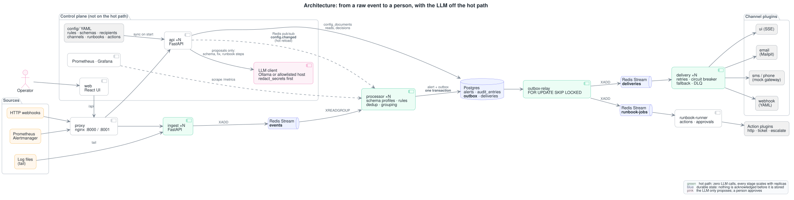
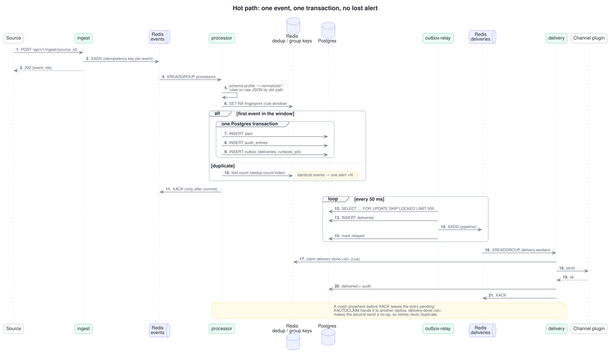
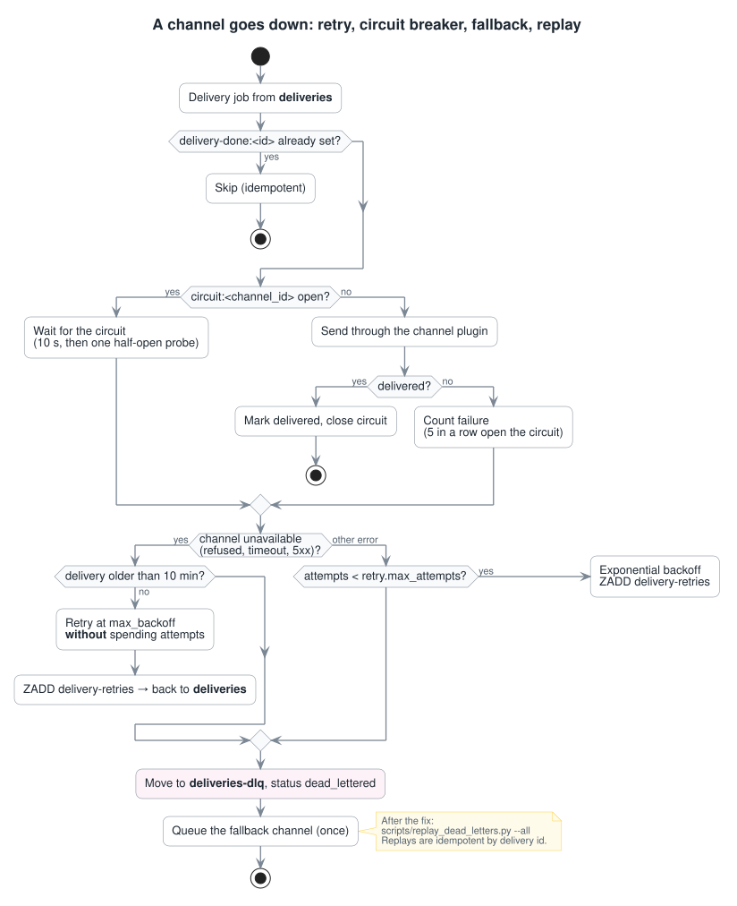
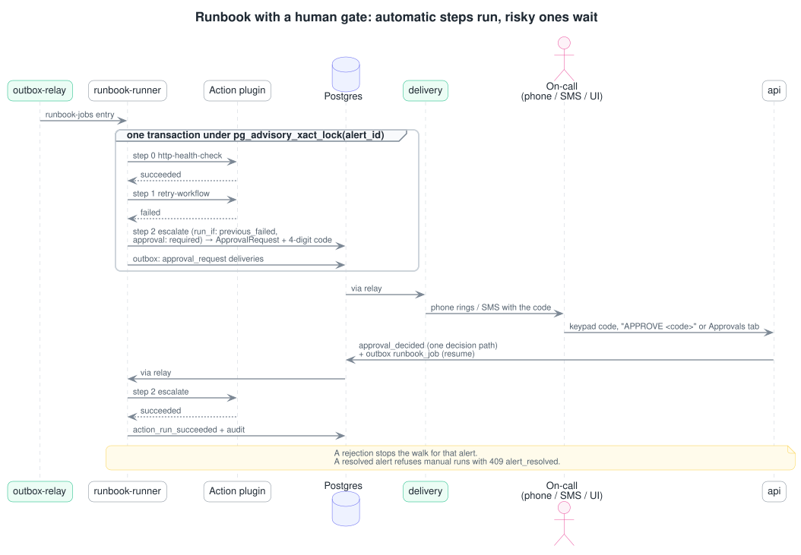
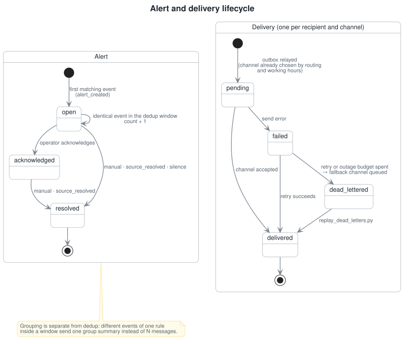
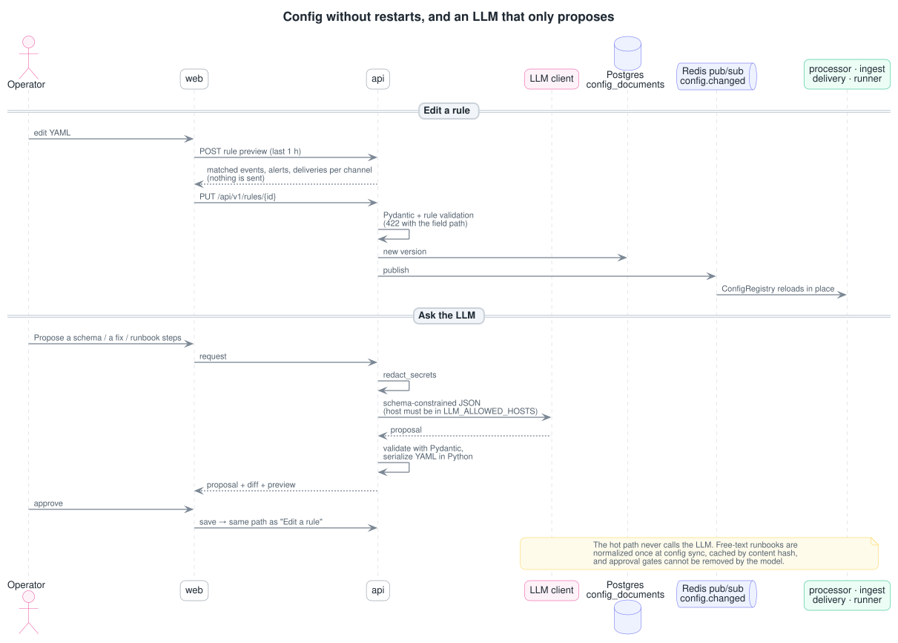

# Architecture

How an event becomes a message to a person, and what keeps that path fast and lossless. Every
diagram is PlantUML source in [`diagrams/`](diagrams/) with a rendered SVG next to it; after
editing a `.puml` file, re-render with `plantuml -tsvg docs/diagrams/*.puml`.

## Components

- **Hot path** (green): `ingest` → Redis Stream `events` → `processor` → Postgres → `outbox-relay`
  → `deliveries` / `runbook-jobs` → `delivery` / `runbook-runner`. It makes zero LLM calls. Every
  worker is stateless and scales with `docker compose up -d --scale <service>=N`. The `proxy`
  (nginx) owns host ports 8000 and 8001, so `api` and `ingest` scale too.
- **Durable state** (blue): Redis Streams with consumer groups for work in flight, Postgres for
  alerts, the outbox, deliveries, audit and config. Nothing is acknowledged before it is stored.
- **Control plane**: the React UI talks only to `api`. Config lives as YAML in `config/`, is synced
  into `config_documents` and reaches every worker through the Redis pub/sub channel
  `config.changed`, with no restart.
- **LLM** (pink): local Ollama by default, or an opt-in cloud host listed in `LLM_ALLOWED_HOSTS`.
  `redact_secrets` runs before every call, and every answer is a proposal a person approves.

## Hot path: event to delivery

- **The alert and its outbox rows are written in one Postgres transaction**, so an alert never
  exists without its deliveries and vice versa. The `events` entry is acknowledged only after the
  commit.
- `outbox-relay` takes batches of up to 500 rows with `FOR UPDATE SKIP LOCKED`, so relay replicas
  never block each other or send a row twice.
- A crashed worker leaves its entries pending; `XAUTOCLAIM` hands them to another replica.
  `delivery-done:<id>` (24 h TTL) makes the repeated send a no-op.
- **Dedup and grouping are separate.** Identical events, by the rule's fingerprint inside its
  window, fold into one alert with a count (`×500`). Different events of one rule inside a group
  window become one summary message.

## Channel outage: retry, circuit breaker, fallback, replay

An unreachable channel (connection refused, timeout, 5xx) keeps retrying at `retry.max_backoff`
without spending attempts for up to 10 minutes. The per-channel circuit breaker is shared by all
`delivery` replicas: 5 failures in a row open it for 10 s, then one probe is let through. Only
after the outage budget runs out is the delivery dead-lettered to `deliveries-dlq` and its
fallback channel queued. `scripts/replay_dead_letters.py` re-sends dead letters once the cause is
fixed. Measured result: a 60 s SMS outage loses nothing ([load-test results](load-test-results.md)).

## Runbooks with a human gate

Runbooks in YAML, Markdown or free text normalize to one step model. Automatic steps run at once.
A step with `approval: required` creates an approval request with a 4-digit code and sends it
like any other delivery. The on-call person approves by phone keypad, SMS reply or the Approvals
tab, and the decision resumes the walk through the outbox. The LLM can tighten an approval rule
but never remove one.

## Alert and delivery lifecycle

Alertmanager `resolved` webhooks close the matching alert with `source_resolved`. Routing and
recipients' working hours pick the channel before a delivery row exists, so every delivery
ends `delivered` unless it is dead-lettered, and a dead letter can be replayed.

## Config without restarts, and an LLM that only proposes

Every config change goes through validation (HTTP 422 with the field path), a new version in
`config_documents` and a `config.changed` broadcast. The rule preview replays the last hour of
events and shows matches and deliveries per channel before anything is sent. LLM proposals
(schema profile, rule fix, runbook steps) go through the same validation and save path as a
human edit.

## Related documents

- [glossary.md](glossary.md): names used in code, config and the UI
- [load-test-results.md](load-test-results.md) and [benchmarks.md](benchmarks.md): measured throughput, latency and CPU profiles
- [demo.md](demo.md): the 5-minute demo script
- [`contracts/`](../contracts/): Pydantic models, OpenAPI and storage layout (Redis keys, tables)
