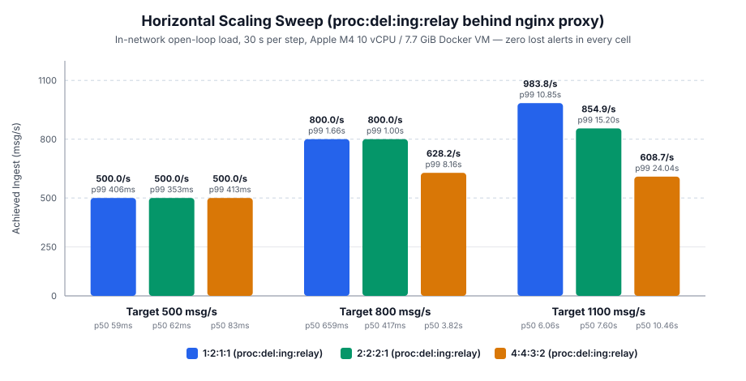
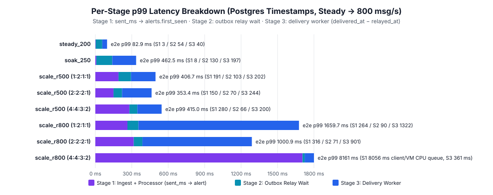
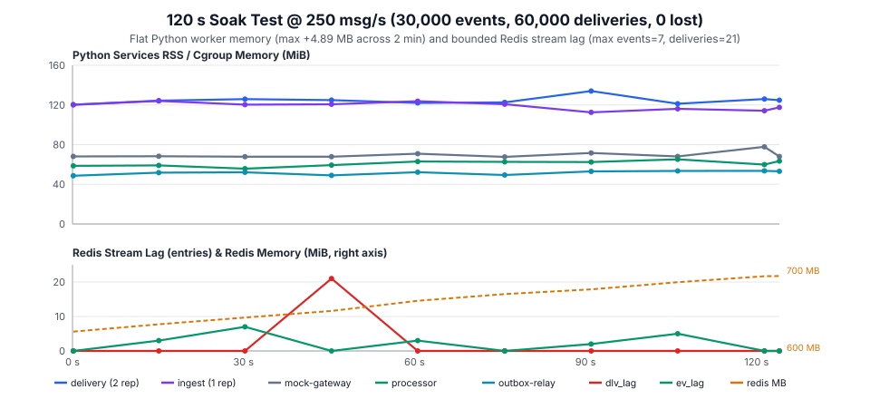
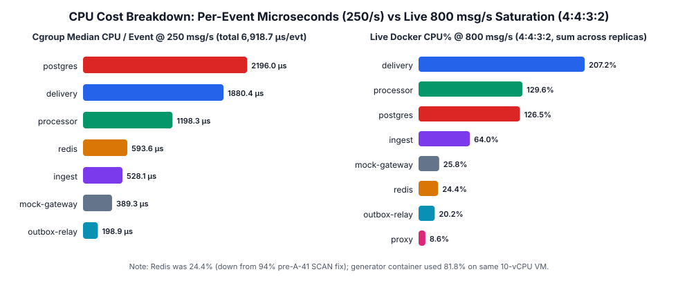
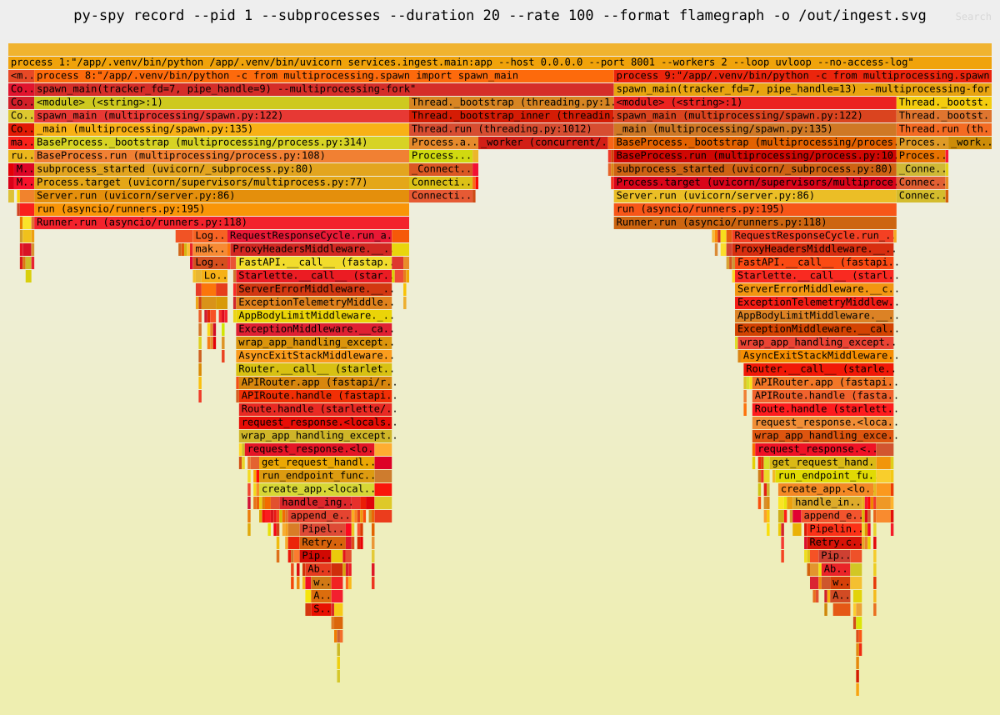
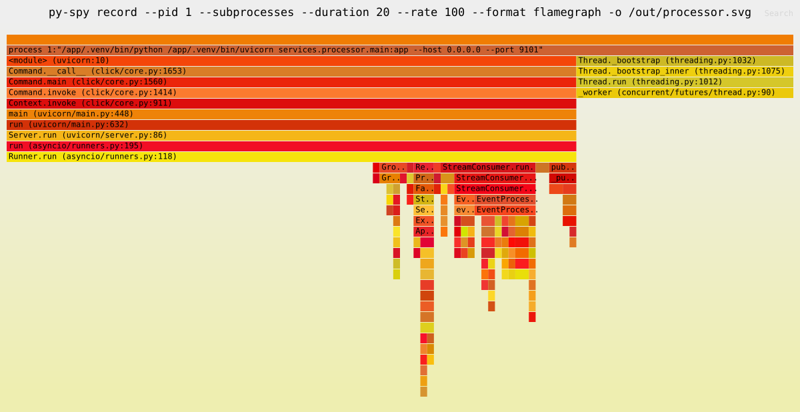
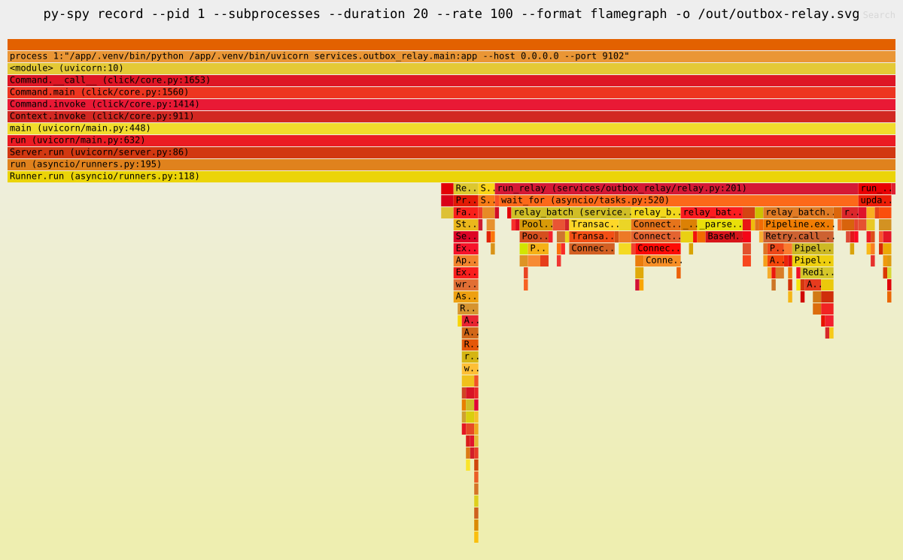
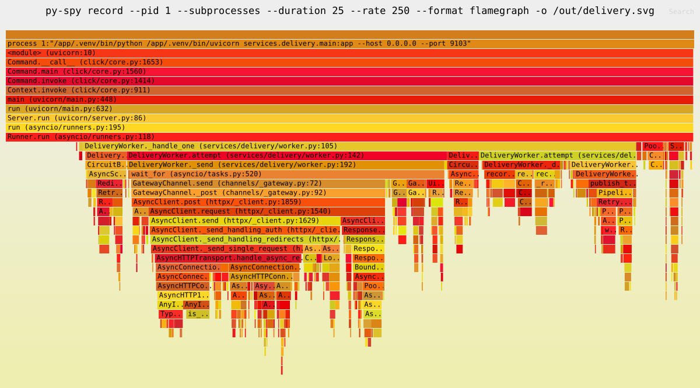

# Benchmarks, Profiling & CPU Flame Graphs

Engineering reference covering the hot-path architecture, full verification suite, end-to-end load and fault-injection benchmarks, horizontal scaling sweep behind the `nginx` proxy, Postgres/Redis backend profiles, and `py-spy` CPU flame graphs.

All final numbers below were measured on **2026-11-21** against commit `15dbce7` (based on `main` `d03de0f` with the `/tmp/prometheus` tmpfs permission fix in `compose.yaml`) on an otherwise quiet machine with only the `alerting` Compose project running. Raw JSON results live in `loadtest/results/` (gitignored).

---

## 1. Hot-Path Architecture & Code Map

```mermaid
flowchart LR
    Src["Webhook / Alertmanager / Log Tail"] -->|"HTTP :8001"| Proxy["proxy (nginx :8000 / :8001)"]
    Proxy -->|"keepalive + DNS resolve (5s)"| Ingest["ingest (FastAPI + uvloop)"]
    Ingest -->|"Lua XADD / idempotency pipeline"| EvStream[("Redis Stream: events")]
    EvStream -->|"XREADGROUP + XAUTOCLAIM (30s)"| Proc["processor workers"]
    Proc <-->|"SET NX + GET + dedup-count-index"| RedisState[("Redis dedup & group keys")]
    Proc -->|"1 Postgres tx: alerts + audit_entries + outbox"| PG[("Postgres 16")]
    PG -->|"FOR UPDATE SKIP LOCKED LIMIT 500 (50ms poll)"| Relay["outbox-relay"]
    Relay -->|"INSERT deliveries + XADD pipeline"| DlvStream[("Redis Stream: deliveries")]
    DlvStream -->|"XREADGROUP"| Del["delivery workers (×2 default)"]
    Del <-->|"Lua claim/complete + circuit:<channel_id>"| RedisState
    Del -->|"HTTP / SMTP"| Channels["Channel plugins (ui, email, sms, phone, webhook)"]
    Del -->|"record_outcome + audit_entries"| PG
    Relay -->|"runbook_job XADD"| RbStream[("Redis Stream: runbook-jobs")]
    RbStream --> Runner["runbook-runner (approvals + actions)"]
```



| Stage | Service / Module | Key Mechanism on Hot Path | Zero-LLM Guarantee |
|---|---|---|---|
| Edge proxy | `proxy` ([deploy/nginx/nginx.conf](../deploy/nginx/nginx.conf)) | Round-robins `:8000` (`api`, SSE unbuffered) and `:8001` (`ingest`) over Compose DNS (`resolver 127.0.0.11 valid=5s`) | Pure L7 reverse proxy |
| Event ingestion | `ingest` ([services/ingest/main.py](../services/ingest/main.py)) | Validates source & payload, assigns ULID, runs pipelined Redis `XADD` (or Lua `SET NX` + `XADD` when `Idempotency-Key` is set); `--no-access-log` avoids per-request logger CPU | No LLM calls |
| Rule & dedup worker | `processor` ([services/processor/batch.py](../services/processor/batch.py), [folds.py](../services/processor/folds.py), [dedup.py](../packages/alerting_core/alerting_core/dedup.py)) | Evaluates conditions & templates in memory, claims `dedup:<rule_id>:<fingerprint>` in one Redis pipeline, inserts `alerts` + `audit_entries` + `outbox` in one Postgres tx, adopts idle fold counters via `dedup-count-index` sorted set + Lua | No LLM calls |
| Transactional outbox | `outbox-relay` ([services/outbox_relay/relay.py](../services/outbox_relay/relay.py), [reconcile.py](../services/outbox_relay/reconcile.py)) | Claims up to 500 rows with `FOR UPDATE SKIP LOCKED` every 50 ms, bulk-inserts `deliveries`, pipelines `XADD` to `deliveries`/`runbook-jobs`, marks `relayed_at` in one tx | No LLM calls |
| Channel dispatch | `delivery` ([services/delivery/worker.py](../services/delivery/worker.py), [circuit.py](../services/delivery/circuit.py), [records.py](../services/delivery/records.py)) | Single Lua round trip checks `delivery-done:<delivery_id>` (24 h TTL) and per-channel circuit breaker (`claim_attempt`), sends via channel plugin, completes attempt in Lua (`complete_attempt`), persists `deliveries` + `audit_entries` + pipelined team SSE publish | No LLM calls |

> [!NOTE]
> The LLM (`alerting_core.llm.LlmClient`) is strictly off the hot path: it runs only on config sync in `api` (guarded by a Postgres session advisory lock), `PUT /api/v1/runbooks/{id}`, schema profile proposals, and fix proposals.

---

## 2. Environment & Full Verification Suite

| Component | Measured Specification |
|---|---|
| Host hardware | Apple M4 (10 cores, 16 GB RAM), macOS 27.0.1 (Build `26A434`, `arm64`) |
| Docker Engine / VM | Docker 29.9.2 (`desktop-linux`), 10 vCPUs, 7.75 GiB (`8,319,438,848` bytes) VM RAM |
| Default stack topology | `ingest` (1 replica × 2 uvicorn `--loop uvloop --no-access-log` workers), `processor` (1), `outbox-relay` (1), `delivery` (2), `runbook-runner` (1), `api` (1), `proxy` (1 nginx), `mock-gateway` (1), `postgres:16.13`, `redis:7.4.12` (AOF `everysec`), `mailpit`, `prometheus`, `alertmanager`, `grafana`, `web` |
| Git revision | `15dbce7` on `docs/final-benchmarks` (clean `origin/main` `d03de0f` with PR #33 A-41 + PR #34 + `compose.yaml` `/tmp/prometheus` uid/gid fix) |

All repository checks ran against the fresh stack before benchmarking:

| Check | Command | Result | Notes |
|---|---|---|---|
| Python unit suite | `uv run pytest -q` | **864 passed** (`23 deselected`, `21.20s`) | Integration tests run separately below |
| Docker integration suite | `uv run pytest -m integration tests/integration -q` | **2 passed** (`48.44s`) | 200 SMS outage recovery + `docker kill` of delivery worker |
| Cumulative smoke test | `uv run python scripts/smoke_test.py --gate 14h` | **21/22 passed** (`run 7fa35f45`) | 1 expected failure: Anna's `08:00-20:00 Europe/Warsaw` working-hours SMS check ran at ~05:35 local time |
| Python lint & format | `uv run ruff check . && uv run ruff format --check .` | **Passed** (`326 files already formatted`) | Zero warnings/errors |
| Contract drift check | `uv run python scripts/generate_contracts.py --check` | **Passed** (`28 files`) | OpenAPI, JSON Schemas, TS types in sync |
| Web lint & typecheck | `cd web && npm run lint && npm run typecheck` | **Passed** (`0` ESLint errors, `0` TS errors) | 1 pre-existing fast-refresh warning in `ModelMark.tsx` |

---

## 3. Master Benchmark Summary (2026-11-21)

Every scenario below settled with **`lost = 0`** (`is_settled = true`) and **`0` HTTP 5xx errors**. Load scenarios route through `proxy` (`http://localhost:8001` from host for single/fault runs; `http://proxy:8001` inside `alerting_default` for `scale`, `soak`, `cpu_bench`, and `profile_backends`).

| Benchmark | Config (`p:d:i:r`) | Target msg/s | Achieved msg/s | Alerts / Folded | Delivered | Lost | p50 | p99 | Max Lag (`ev` / `dlv`) | Result JSON (`loadtest/results/`) |
|---|---|---:|---:|---:|---:|---:|---:|---:|---|---|
| Steady 60 s (host) | `1:2:1:1` | 200 | **200.0** | 12,000 / 12,000 | 24,000 / 24,000 | **0** | **41.1 ms** | **83.8 ms** | 2 / 22 | `steady-20261121T043841.json` |
| Dup storm (host) | `1:2:1:1` | 1,000 | **781.7** | 1 / 5,000 | 2 / 2 | **0** | n/a (fold) | n/a (fold) | 11 / 0 | `dup-storm-20261121T044008.json` |
| Gateway down 60 s (host) | `1:2:1:1` | 100 | **100.0** | 9,000 / 9,000 | 18,000 / 18,000 | **0** | **57.2 ms** | **68.62 s** | 18 / 6,710 | `gateway-down-20261121T044047.json` |
| Kill processor (host) | `2:2:1:1` → `1` | 200 | **200.0** | 12,000 / 12,000 | 24,000 / 24,000 | **0** | **40.6 ms** | **134.9 ms** | 9 / 44 | `kill-processor-20261121T045142.json` |
| Scale `final-r500` | `1:2:1:1` | 500 | **500.0** | 15,000 / 15,000 | 30,000 / 30,000 | **0** | 59.2 ms | 406.2 ms | 15 / 176 | `scale-20261121T045320.json` |
| Scale `final-r500` | `2:2:2:1` | 500 | **500.0** | 15,000 / 15,000 | 30,000 / 30,000 | **0** | 61.7 ms | **353.2 ms** | 20 / 194 | `scale-20261121T045320.json` |
| Scale `final-r500` | `4:4:3:2` | 500 | **500.0** | 15,000 / 15,000 | 30,000 / 30,000 | **0** | 83.3 ms | 413.4 ms | 10 / 85 | `scale-20261121T045320.json` |
| Scale `final-r800` | `1:2:1:1` | 800 | **800.0** | 24,000 / 24,000 | 48,000 / 48,000 | **0** | 659.1 ms | 1,658.0 ms | 969 / 2,446 | `scale-20261121T045704.json` |
| Scale `final-r800` | `2:2:2:1` | 800 | **800.0** | 24,000 / 24,000 | 48,000 / 48,000 | **0** | **416.9 ms** | **1,000.7 ms** | 9 / 1,483 | `scale-20261121T045704.json` |
| Scale `final-r800` | `4:4:3:2` | 800 | 628.2 | 24,000 / 24,000 | 48,000 / 48,000 | **0** | 3,815.4 ms | 8,159.1 ms | 66 / 393 | `scale-20261121T045704.json` |
| Scale `final-r1100` | `1:2:1:1` | 1,100 | **983.8** | 33,000 / 33,000 | 66,000 / 66,000 | **0** | 6,063.5 ms | 10,852.0 ms | 183 / 13,388 | `scale-20261121T050027.json` |
| Scale `final-r1100` | `2:2:2:1` | 1,100 | 854.9 | 33,000 / 33,000 | 66,000 / 66,000 | **0** | 7,599.1 ms | 15,195.3 ms | 210 / 11,594 | `scale-20261121T050027.json` |
| Scale `final-r1100` | `4:4:3:2` | 1,100 | 608.7 | 33,000 / 33,000 | 66,000 / 66,000 | **0** | 10,455.1 ms | 24,044.2 ms | 212 / 664 | `scale-20261121T050027.json` |
| Soak 120 s | `1:2:1:1` | 250 | **250.0** | 30,000 / 30,000 | 60,000 / 60,000 | **0** | **43.2 ms** | **461.3 ms** | 7 / 21 | `soak-20261121T050406.json` |
| Backend profile 30 s | `1:2:1:1` | 500 | **500.0** | 15,000 / 15,000 | 30,000 / 30,000 | **0** | 60.3 ms | 289.7 ms | — | `backend-profile-20261121T050653.json` |
| CPU bench (3 × 30 s median) | `1:2:1:1` | 250 | **250.0** | 7,500 / 7,500 | 15,000 / 15,000 | **0** | **42.4 ms** | **94.1 ms** | — | `cpu-bench-20261121T050809.json` |

---

## 4. Benchmark Deep Dives

### 4.1 Steady-State Baseline (`steady --duration 60`)

```bash
uv run python loadtest/scenarios.py steady --duration 60
```

- **Run:** `steady-30c8ccb9` (`steady-20261121T043841.json`), 200.0 msg/s over 60 s from host through `nginx` `proxy:8001` (`16` HTTP keep-alive connections).
- **HTTP ingest latency:** p50 **1.7 ms**, p99 **5.1 ms** (zero errors across 12,000 POSTs).
- **Per-channel end-to-end latency (`delivered_at - sent_ms`, corrected for host-to-VM clock offset):**
  - `ui` (`n=12,000`): p50 **37.7 ms**, p95 **58.5 ms**, p99 **74.6 ms**, max **152.6 ms**.
  - `sms` (`n=12,000`): p50 **45.3 ms**, p95 **65.3 ms**, p99 **88.8 ms**, max **187.2 ms**.
  - Combined (`n=24,000`): p50 **41.1 ms**, p95 **62.8 ms**, p99 **83.8 ms**, max **187.2 ms**.
- **Stream drain:** `events` drained in **0.14 s** (max lag `2`, max pending `3`).

### 4.2 Deduplication Storm (`dup-storm`)

```bash
uv run python loadtest/scenarios.py dup-storm
```

- **Run:** `dup-storm-9c6d88eb` (`dup-storm-20261121T044008.json`), 5,000 events sharing one `evt` fingerprint sent at target 1,000 msg/s (`achieved_ingest_msg_s = 781.7/s`, ingest HTTP p50 **8.2 ms**, p99 **120.6 ms**).
- **Deduplication correctness:** Exactly **1 alert** created (`processed_alerts = 1`, `processed_events = 5000`, `delivered = 2/2` primary rows: 1 `ui`, 1 `sms`, `lost = 0`).
- **How it works in code:** In [services/processor/batch.py](../services/processor/batch.py), `group_matches()` collapses matching events with the same `(rule_id, fingerprint)` within each consumer batch before hitting Redis. Across batches, `claim_dedup_keys()` ([dedup.py](../packages/alerting_core/alerting_core/dedup.py)) pipelines `SET dedup:<rule_id>:<fingerprint> <candidate_id> NX PX <window_ms>` + `GET`, so exactly one event creates the alert row and all 4,999 folds add deltas via `record_folds()` (`INCRBY` + `ZADD dedup-count-index`). `FoldTracker.flush()` ([folds.py](../services/processor/folds.py)) coalesces count updates into Postgres at most once per second via `GETDEL`.

### 4.3 Gateway Outage Recovery (`gateway-down`)

```bash
uv run python loadtest/scenarios.py gateway-down
```

- **Run:** `gateway-down-5743cc90` (`gateway-down-20261121T044047.json`), 100.0 msg/s for 90 s (`9,000` alerts, `18,000` deliveries), stopping `alerting-mock-gateway-1` at `t=10 s` for `60 s`.
- **Outcome:** `18,000 / 18,000` primary deliveries succeeded (`covered_by_fallback = 0`, `lost = 0`, `events` drained in **0.14 s**).
- **Channel isolation & circuit breaker:**
  - `ui` (`n=9,000`, purely internal DB+SSE): p50 **38.5 ms**, p95 **657.5 ms**, p99 **3,950.8 ms**, max **4,744.7 ms**. Two `delivery` replicas plus the `sms` circuit breaker (`circuit:sms` in [services/delivery/circuit.py](../services/delivery/circuit.py)) kept `ui` p50 near steady-state (**38.5 ms**) while parking `sms` jobs in `delivery-retries` instead of blocking the asyncio worker pool on HTTP timeouts.
  - `sms` (`n=9,000`): p50 **28,349.6 ms**, p95 **66,086.5 ms**, p99 **69,433.7 ms**, max **70,356.2 ms** (matching the 60 s outage plus retry backoff and backlog drain; `MAX_OUTAGE_SECONDS = 600 s` in [services/delivery/worker.py](../services/delivery/worker.py), so jobs waited cleanly for `mock-gateway` recovery without dead-lettering).

### 4.4 Processor Crash Recovery (`kill-processor`)

```bash
uv run python loadtest/scenarios.py kill-processor
```

- **Run:** `kill-processor-d5ed2256` (`kill-processor-20261121T045142.json`), 200.0 msg/s for 60 s with `processor=2`; `docker kill` terminated the second replica at `t=20 s`.
- **Outcome:** `12,000` alerts, `24,000 / 24,000` delivered, **`lost = 0`**, `p50 = 40.6 ms`, `p99 = 134.9 ms`, `events` drained in **0.06 s**.
- **Exact `XAUTOCLAIM` signature:** Maximum latency was **31,541.1 ms** (`ui` max 31,533.1 ms, `sms` max 31,541.1 ms) — matching the **30 s** `XAUTOCLAIM` idle threshold in `StreamConsumer` ([alerting_core/streams.py](../packages/alerting_core/alerting_core/streams.py)) when the surviving `processor-1` reclaimed pending stream entries held by the killed container. Any `dedup-count:*` deltas left un-flushed by the dead replica are adopted by `adopt_orphans()` via `dedup-count-index` after `ORPHAN_IDLE_SECONDS = 10 s`.
- *Note on an earlier aborted-timing attempt (`kill-processor-20261121T044243.json`):* macOS entered host idle sleep twice during that run (gaps of 282.4 s and 112.1 s in the lag sampler), slowing wall-clock ingest to 26.4 msg/s; even through two host sleep cycles, `lost` was **0** (`12,000` alerts, `24,000/24,000` delivered, p50 35.0 ms, p99 549.3 ms).

### 4.5 Horizontal Scaling Sweep & Per-Stage Latency (`final-r500`, `final-r800`, `final-r1100`)

```bash
for r in 500 800 1100; do
  uv run python loadtest/soak_and_scale.py --mode scale --rate $r --duration 30 \
    --pairs "1:2:1:1,2:2:2:1,4:4:3:2" --label final-r$r
done
```

Replica tuple notation is `processor:delivery:ingest:outbox-relay` (`p:d:i:r`). `ingest` replicas sit behind `proxy:8001` (`nginx`, 5 s DNS re-resolve). All three runs generated inside `alerting_default` against `http://proxy:8001`.



| Target msg/s | Config (`p:d:i:r`) | Achieved msg/s | Processed msg/s | p50 | p99 | Max Lag (`ev` / `dlv`) | Drain | Lost | Stage 1 p50 / p99 (ingest+proc) | Stage 2 p50 / p99 (relay wait) | Stage 3 p50 / p99 (delivery) | Run Label & File |
|---:|---|---:|---:|---:|---:|---|---:|---:|---:|---:|---:|---|
| 500 | `1:2:1:1` | **500.0** | 500.5 | 59.2 ms | 406.2 ms | 15 / 176 | 0.06 s | **0** | 0.5 / 191.1 ms | 29.0 / 102.8 ms | 28.2 / 201.9 ms | `final-r500` (`scale-20261121T045320.json`) |
| 500 | `2:2:2:1` | **500.0** | 500.3 | 61.7 ms | **353.2 ms** | 20 / 194 | 0.09 s | **0** | 0.7 / 149.8 ms | 28.7 / 69.5 ms | 30.6 / 243.7 ms | `final-r500` (`scale-20261121T045320.json`) |
| 500 | `4:4:3:2` | **500.0** | 500.5 | 83.3 ms | 413.4 ms | 10 / 85 | 0.16 s | **0** | 1.7 / 280.4 ms | 26.5 / 65.6 ms | 37.8 / 199.9 ms | `final-r500` (`scale-20261121T045320.json`) |
| 800 | `1:2:1:1` | **800.0** | 800.6 | 659.1 ms | 1,658.0 ms | 969 / 2,446 | 0.19 s | **0** | 1.8 / 264.4 ms | 33.8 / 90.3 ms | 544.0 / 1,322.0 ms | `final-r800` (`scale-20261121T045704.json`) |
| 800 | `2:2:2:1` | **800.0** | 800.7 | **416.9 ms** | **1,000.7 ms** | 9 / 1,483 | 0.08 s | **0** | 2.4 / 316.2 ms | 32.3 / 71.0 ms | 325.4 / 901.4 ms | `final-r800` (`scale-20261121T045704.json`) |
| 800 | `4:4:3:2` | 628.2 | 628.7 | 3,815.4 ms | 8,159.1 ms | 66 / 393 | 0.20 s | **0** | 3,713.0 / 8,055.8 ms | 27.2 / 83.9 ms | **51.4 / 360.7 ms** | `final-r800` (`scale-20261121T045704.json`) |
| 1,100 | `1:2:1:1` | **983.8** | 984.6 | 6,063.5 ms | 10,852.0 ms | 183 / 13,388 | 0.06 s | **0** | 1,735.0 / 3,652.0 ms | 34.2 / 108.5 ms | 4,292.2 / 7,988.9 ms | `final-r1100` (`scale-20261121T050027.json`) |
| 1,100 | `2:2:2:1` | 854.9 | 855.5 | 7,599.1 ms | 15,195.3 ms | 210 / 11,594 | 0.22 s | **0** | 3,956.2 / 8,556.0 ms | 33.2 / 158.2 ms | 3,591.6 / 7,688.3 ms | `final-r1100` (`scale-20261121T050027.json`) |
| 1,100 | `4:4:3:2` | 608.7 | 609.1 | 10,455.1 ms | 24,044.2 ms | 212 / 664 | 0.10 s | **0** | 10,370.8 / 23,798.8 ms | 26.9 / 101.7 ms | **49.8 / 562.3 ms** | `final-r1100` (`scale-20261121T050027.json`) |



**What Postgres timestamps reveal about horizontal scaling on a single 10-vCPU VM:**
1. **Optimal single-VM topology is `2:2:2:1`:** At **800 msg/s**, adding a second `processor` and `ingest` (`1:2:1:1` → `2:2:2:1`) keeps full **800.0 msg/s** throughput, slashes `events` lag from `969` to `9`, and cuts e2e latency by **37–40%** (p50 `659.1 ms → 416.9 ms`, p99 `1,658.0 ms → 1,000.7 ms`).
2. **Adding more workers helps downstream stages, but 15+ containers oversubscribe 10 VM vCPUs:** Under `4:4:3:2` at 800 and 1,100 msg/s, **Stage 3 (`delivery` ×4)** completely eliminates the delivery backlog (`deliveries` lag drops from `2,446 → 393` at 800 msg/s and `13,388 → 664` at 1,100 msg/s; Stage 3 p99 drops to **360.7 ms** and **562.3 ms**). However, running 13 Python/uvicorn worker processes + `proxy` + `mock-gateway` + `postgres` + `redis` + the open-loop load generator (81.8% CPU) inside the same 10-vCPU VM starves HTTP scheduling, pushing **Stage 1 (`sent_ms → alerts.first_seen`)** up to 8.06 s p99 at 800 msg/s and 23.80 s p99 at 1,100 msg/s.
3. **Peak single-machine throughput:** With fewer competing worker processes, `1:2:1:1` leaves more vCPU budget for `postgres` and the generator and reaches **983.8 msg/s** (33,000 alerts, 66,000/66,000 delivered, `lost = 0`).

### 4.6 120 s Soak Stability (`soak --rate 250 --duration 120`)

```bash
uv run python loadtest/soak_and_scale.py --mode soak --rate 250 --duration 120
```

- **Run:** `steady-1e4664a4` (`soak-20261121T050406.json`), 30,000 events / 60,000 deliveries over 120 s at 250.0 msg/s, `lost = 0`, `p50 = 43.2 ms` (stage-1 0.5 ms, relay 28.0 ms, delivery 13.8 ms), `p99 = 461.3 ms`, `drain = 0.17 s`.
- **Stream lag bounded:** max `events_lag = 7`, max `deliveries_lag = 21` across all 10 samples (`t = 0.14..122.07 s`).



| Service | Replicas | Min RSS (MiB) | Max RSS (MiB) | Growth (MiB) | Slope (MiB/min) | Avg CPU% |
|---|---:|---:|---:|---:|---:|---:|
| `delivery` | 2 | 120.29 | 134.07 | +4.51 | +1.465 | 47.4% |
| `ingest` | 1 | 112.57 | 124.07 | -2.48 | -3.596 | 13.9% |
| `processor` | 1 | 55.82 | 65.16 | +4.89 | +2.648 | 29.2% |
| `outbox-relay` | 1 | 48.64 | 53.54 | +4.47 | +1.735 | 4.9% |
| `mock-gateway` | 1 | 67.64 | 77.85 | -0.02 | +2.072 | 9.8% |
| `redis` | 1 | 622.41 | 686.91 | +64.50 | +31.688 | 12.6% |
| `postgres` | 1 | 4,245.39 | 4,673.54 | +355.68 | +153.487 | 46.2% |
| **Total (8 containers)** | **8** | **5,283.47** | **5,779.89** | **+431.55** | **+189.499** | **163.9%** |

Python worker memory stays flat (`-2.48 MiB` to `+4.89 MiB` over 30,000 events — zero leak). `redis` growth (`+64.50 MiB`) reflects new stream entries and `dedup:*` / `delivery-done:*` keys within their 24 h TTL / 2 h stream trim window; `postgres` growth reflects shared-buffer / page-cache allocation for 30,000 `alerts`, 60,000 `deliveries`, and 90,000 `audit_entries`.

### 4.7 Per-Event CPU Accounting (`cpu_bench.py`) & 800 msg/s Saturation Snapshot

```bash
uv run python loadtest/cpu_bench.py --rate 250 --duration 30 --runs 3 --label final-cpu-250
```

- **Run:** `cpu-bench-20261121T050809.json`, 3 runs × 7,500 events @ 250.0 msg/s (`all_zero_lost = true`, median `p50 = 42.4 ms`, median `p99 = 94.1 ms`).
- Total cgroup CPU across the 8 pipeline containers fell from **9,795.7 µs/evt** (historical pre-A-24 `main`) to **6,918.7 µs/evt** (**−29.4%** end-to-end CPU per event across A-24, A-34, and A-41).



| Service | Replicas (250/s) | Median CPU / evt @ 250/s | Median CPU% @ 250/s | Live CPU% @ 800/s (`4:4:3:2` snapshot) |
|---|---:|---:|---:|---|
| `postgres` | 1 | 2,196.0 µs | 51.1% | **126.48%** |
| `delivery` | 2 (4 @ 800/s) | 1,880.4 µs | 43.5% | **207.17%** (`55.56% + 40.61% + 54.36% + 56.64%`) |
| `processor` | 1 (4 @ 800/s) | 1,198.3 µs | 28.0% | **129.56%** (`24.83% + 25.74% + 40.57% + 38.42%`) |
| `redis` | 1 | 593.6 µs | 13.6% | **24.42%** *(down from 94% pre-A-41 `SCAN` fix)* |
| `ingest` | 1 (3 @ 800/s) | 528.1 µs | 12.3% | **64.03%** (`17.36% + 17.67% + 29.00%`) |
| `mock-gateway` | 1 | 389.3 µs | 8.8% | **25.75%** |
| `outbox-relay` | 1 (2 @ 800/s) | 198.9 µs | 4.7% | **20.22%** (`5.10% + 15.12%`) |
| `proxy` (nginx) | 1 | — | — | **8.56%** |
| **Pipeline Total** | **8 (18 @ 800/s)** | **6,918.7 µs** | **158.8%** | **606.19%** *(plus 81.81% in-network generator)* |

---

## 5. CPU Flame Graphs & Code-Level Hot-Path Analysis

Interactive `py-spy` SVG flame graphs (`docs/profiles/*.svg`, click any frame to zoom, `Ctrl+F` to search) were recorded on the final stack under **500 msg/s** in-network steady load (each pass settled with `lost = 0`). Historical pre-A-24 profiles (`loadtest/results/profiles/{ingest,delivery}.svg`) remain in the repository for direct before/after comparison.

### 5.1 `ingest` — FastAPI + uvloop + Pipelined Redis `XADD`

- **Post-A-41 Flame Graph (`341` active samples, `0` errors @ 100 Hz over 20 s):** [profiles/ingest.svg](profiles/ingest.svg) *(load run `steady-20261121T051246.json`, `lost = 0`, 499.7/s)*
- **Historical Pre-A-24 Baseline (`1,653` samples):** [../loadtest/results/profiles/ingest.svg](../loadtest/results/profiles/ingest.svg)



| Frame (`services/ingest` hot path) | Post-A-41 Inclusive Samples | Post-A-41 Share | What It Executes |
|---|---:|---:|---|
| `RequestResponseCycle.run_asgi` / `ProxyHeadersMiddleware.__call__` | 113 / 341 | 33.1% | `httptools` C HTTP parser + ASGI dispatch across 2 uvicorn workers |
| `ingest_event` / `handle_ingest` (`services/ingest/main.py`) | 73 / 341 | 21.4% | Source lookup (in-memory dict swap on reload), JSON parse, ULID envelope construction |
| `append_envelopes` (`services/ingest/main.py`) | 48 / 341 | 14.1% | Pipelined Redis `XADD` (or `evalsha` when `Idempotency-Key` header is supplied) |
| `Pipeline.execute` (`redis/asyncio/client.py`) | 42 / 341 | 12.3% | Packed RESP command serialization & non-transactional pipeline flush |
| `Process.always_pong` / `pong` (`uvicorn/supervisors/multiprocess.py`) | 42 / 341 | 12.3% | Uvicorn parent supervisor health heartbeat to the 2 worker subprocesses |
| `LogTailSet._run_after` / `start_tail` (`services/ingest/sources.py`) | 12 / 341 | 3.5% | `log-tail-lock:*` lock renewal and file watch loop |

**Before → After (`--no-access-log` in A-24):** In [pre-A-24 ingest.svg](../loadtest/results/profiles/ingest.svg), `StreamHandler.emit` (**3.5% self-time**), `LogRecord.__init__` (**1.8% self-time**), and `JsonFormatter.format` (**0.7%**) consumed ~6–9% of `ingest` CPU formatting per-request access logs. In [profiles/ingest.svg](profiles/ingest.svg), logging frames dropped to **0%** of top self-time while `alerting_core.logging.configure_logging` preserves the disabled `uvicorn.access` logger.

### 5.2 `processor` — Stream Consumer, Evaluation, Dedup & Atomic Postgres Tx

- **Post-A-41 Flame Graph (`116` active samples, `0` errors @ 100 Hz over 20 s):** [profiles/processor.svg](profiles/processor.svg) *(load run `steady-20261121T051541.json`, `lost = 0`, 490.0/s)*



| Frame (`services/processor` hot path) | Inclusive Samples | Share | What It Executes |
|---|---:|---:|---|
| `StreamConsumer.run` / `read_once` (`alerting_core/streams.py`) | 14 / 116 | 12.1% | `XREADGROUP COUNT 100 BLOCK 1000` loop + batch ack |
| `StreamConsumer._handle` / `EventProcessor.handle_batch` (`services/processor/batch.py`) | 12 / 116 | 10.3% | Pydantic `EventEnvelope.model_validate_json`, pure-Python rule evaluation, batch grouping |
| `EventProcessor._persist_with_retry` / `_persist` (`services/processor/batch.py`) | 9 / 116 | 7.8% | `claim_dedup_keys` pipeline, `decide()`, throttle check, single Postgres tx (`alerts` + `audit_entries` + `outbox` + `unknown_schema_samples`) |
| `Retry.call_with_retry` (`redis/asyncio/retry.py`) | 5 / 116 | 4.3% | Redis dedup claim & team pub/sub calls |
| `Connection.fetch` / `__execute` (`asyncpg/connection.py`) | 4 / 116 | 3.4% | Batch `jsonb_populate_recordset` / `unnest` queries |
| `GroupFlusher.run` / `flush_due` (`services/processor/groups.py`) | 4 / 116 | 3.4% | Background deadline check on `group-deadlines` sorted set |
| `publish_team_event` (`alerting_core/publishing.py`) | 4 / 116 | 3.4% | Live SSE broadcast to `alerts.team.<team_id>` |
| `evaluate_event` / `_render_match` (`services/processor/evaluation.py`) | 3 / 116 | 2.6% | Condition tree evaluation and `{{path}}` title/body/runbook templating |

**Key observation (`SCAN` → `dedup-count-index`):** In [services/processor/folds.py](../services/processor/folds.py), `adopt_orphans()` previously executed `SCAN` across ~2.5 M Redis keys (dominated by `delivery-done:*` keys kept for 7 days) every 30 s per replica. Replacing `SCAN` with `ZRANGEBYSCORE` + `EXISTS`/`ZREM` in `_IDLE_COUNTERS_SCRIPT` ([dedup.py](../packages/alerting_core/alerting_core/dedup.py)) completely removed `SCAN` from both the CPU flame graph and Redis `INFO commandstats`.

### 5.3 `outbox-relay` — `FOR UPDATE SKIP LOCKED` & Batch Relay

- **Post-A-41 Flame Graph (`215` active samples, `0` errors @ 100 Hz over 20 s):** [profiles/outbox-relay.svg](profiles/outbox-relay.svg) *(load run `steady-20261121T051722.json`, `lost = 0`, 500.0/s)*



| Frame (`services/outbox_relay` hot path) | Inclusive Samples | Share | What It Executes |
|---|---:|---:|---|
| `run_relay` / `relay_batch` (`services/outbox_relay/relay.py`) | 88 / 215 | 40.9% | 50 ms polling loop claiming up to 500 unrelayed rows via `FOR UPDATE SKIP LOCKED` |
| `asyncpg.Connection.execute` / `fetch` / `Transaction` | 20 / 215 | 9.3% | Bulk `INSERT INTO deliveries ... unnest(...)` + `UPDATE outbox SET relayed_at = now()` |
| `Redis` `Pipeline.execute` / `Retry.call_with_retry` | 20 / 215 | 9.3% | Single pipelined `XADD` of all claimed `DeliveryJob` / `RunbookJob` payloads |
| `_parse_row` / `BaseModel.model_validate` (`services/outbox_relay/relay.py`) | 15 / 215 | 7.0% | JSON payload validation (`DeliveryJob` / `RunbookJob`) and serialization |
| `run_stream_lag_collector` / `update_stream_lag` (`alerting_core/metrics.py`) | 9 / 215 | 4.2% | Periodic `XINFO GROUPS` Prometheus gauge update |

Because `outbox-relay` batches up to 500 rows per transaction and per Redis pipeline, it uses only **4.7% CPU** (`198.9 µs/evt`) at 250 msg/s and **20.2%** combined across 2 replicas at 800 msg/s, holding Stage 2 (`relayed_at - created_at`) to **~27–34 ms p50** across every load test.

### 5.4 `delivery` — Channel Dispatch, Lua Circuit Breaker & Postgres Outcome

- **Post-A-41 Flame Graph (`2,171` active samples, `0` errors @ 250 Hz over 25 s):** [profiles/delivery.svg](profiles/delivery.svg) *(load run `steady-20261121T052040.json`, `lost = 0`, 499.7/s)*
- **Historical Pre-A-24 Baseline (`1,778` samples):** [../loadtest/results/profiles/delivery.svg](../loadtest/results/profiles/delivery.svg)



| Frame (`services/delivery` hot path) | Post-A-41 Inclusive Samples | Post-A-41 Share | What It Executes |
|---|---:|---:|---|
| `DeliveryWorker._handle_one` (`services/delivery/worker.py`) | 1,773 / 2,171 | 81.7% | `DeliveryJob` JSON validation + `asyncio.Semaphore(MAX_CONCURRENT_SENDS)` |
| `DeliveryWorker.attempt` (`services/delivery/worker.py`) | 1,737 / 2,171 | 80.0% | Full single-attempt lifecycle: claim → send → complete → record |
| `DeliveryWorker._send` → `GatewayChannel.send` / `_post` (`channels/_gateway.py`) | 1,009 / 2,171 | 46.5% | `httpx.AsyncClient.post` (`36.8%`) over `httpcore` keep-alive pool to `mock-gateway` + `ui` channel SQL insert |
| `DeliveryWorker._delivered` (`services/delivery/worker.py`) | 483 / 2,171 | 22.2% | Post-send Postgres state update and SSE fan-out |
| `record_outcome` (`services/delivery/records.py`) | 237 / 2,171 | 10.9% | `INSERT INTO deliveries ... ON CONFLICT DO UPDATE` + `audit_entries` insert |
| `DeliveryWorker._publish` → `publish_team_events` (`alerting_core/publishing.py`) | 207 / 2,171 | 9.5% | Single pipelined `PUBLISH` of both `delivery.updated` and `audit.appended` events (A-34 optimization) |
| `CircuitBreaker.claim_attempt` / `complete_attempt` (`services/delivery/circuit.py`) | 129 + 99 / 2,171 | 10.5% | Single-round-trip Lua scripts replacing multi-RTT `SET NX` + `HGETALL` + `EXPIRE` (A-34 optimization) |

**Before → After (`sniffio` + A-34 Lua + pipelined publish):**
- In [pre-A-24 delivery.svg](../loadtest/results/profiles/delivery.svg), `_path_stat (<frozen importlib._bootstrap_external>)` was the **#3 self-time consumer in the entire service (7.2%, 128/1,778 samples)** because `httpcore` re-scanned `sys.path` attempting to import `sniffio` on every HTTP call. Adding `"sniffio"` to `pyproject.toml` eliminated `_path_stat` completely (**0%** in [profiles/delivery.svg](profiles/delivery.svg)).
- `GatewayChannel._post` (`httpx` + `httpcore` HTTP/1.1 framing) plus `asyncpg` outcome recording account for ~70% of remaining delivery work, explaining why scaling `delivery` from 2 to 4 replicas cuts Stage 3 p99 from **1,322 ms → 361 ms** at 800 msg/s and **7,989 ms → 562 ms** at 1,100 msg/s when CPU cores are available.

---

## 6. Backend Profiling (`Redis` & `Postgres`)

### 6.1 Redis `INFO commandstats` (800 msg/s Scale Sweep & 500 msg/s Backend Profile)

Measured after `CONFIG RESETSTAT` across the entire 3-step `final-r800` run (`72,000` events, `144,000` deliveries) and via `uv run python loadtest/profile_backends.py --rate 500 --duration 30 --label final-backends-500` (`backend-profile-20261121T050653.json`, `15,000` events, `lost = 0`, `p50 = 60.3 ms`, `p99 = 289.7 ms`):

| Redis Command | `final-r800` Total Calls (72k events) | `final-r800` CPU Time | `final-r800` Share | `profile_backends` @ 500/s Calls/evt | `profile_backends` @ 500/s µs/evt | Source |
|---|---:|---:|---:|---:|---:|---|
| `evalsha` | 289,820 | 3,993.9 ms | 48.8% | 4.014 | 56.76 | `delivery` Lua `claim_attempt` + `complete_attempt` (2 per delivery × 2 deliveries) |
| `set` | 360,107 | 1,116.3 ms | 13.6% | 5.000 | 20.58 | `dedup:*` claim/re-arm + `delivery` idempotency fallback |
| `xreadgroup` | 31,246 | 808.9 ms | 9.9% | 0.790 | 10.96 | `processor` + `delivery` stream consumers |
| `xadd` | 216,000 | 763.7 ms | 9.3% | 3.000 | 9.25 | `1` `events` + `2` `deliveries` per alert |
| `publish` | 573,554 | 477.4 ms | 5.8% | 8.000 | 6.46 | Team SSE + broadcast fan-out (`alert`, `delivery`, `audit`, `phone`) |
| `get` | 216,067 | 411.4 ms | 5.0% | 3.001 | 10.48 | `dedup:*` readback + `delivery-done:*` |
| `xack` | 30,667 | 300.8 ms | 3.7% | 0.787 | 3.61 | Stream batch acks |
| `hmget` / `hget` | 288,000 | 265.0 ms | 3.2% | 4.000 | 2.97 | Per-channel circuit breaker hash lookups |
| `scan` | **0** | **0.0 ms** | **0.0%** | **0.000** | **0.00** | **Eliminated by A-41 `dedup-count-index`** *(was **9.6 s / 30 s** pre-fix)* |
| **Total** | **2,011,769** | **8.190 s** | **100%** | **28.648** | **121.52** | All commands across Redis 7.4.12 |

At `121.52 µs` of single-threaded Redis CPU per event, Redis itself has a theoretical single-core ceiling of ~**8,200 msg/s** for commands alone (ignoring network/event-loop syscall overhead) once `SCAN` is gone — Redis was only **24.4% CPU** during `4:4:3:2` @ 800 msg/s (down from **94%** before A-41).

### 6.2 Postgres `pg_stat_statements` & `pg_stat_user_tables` (500 msg/s × 30 s)

From `backend-profile-20261121T050653.json` (`15,000` alerts, `30,000` deliveries; database already held ~1.85 M `alerts`, ~3.71 M `deliveries`, ~5.56 M `audit_entries`):

| Query / Operation (Hot Path & Maintenance) | Calls | Calls/evt | Total Exec Time | Mean ms | ms/evt |
|---|---:|---:|---:|---:|---:|
| `outbox_relay` reconciler `SELECT o.id ... WHERE o.kind = 'runbook_job' ...` | 4 | 0.000 | 3,307.3 ms | 826.814 ms | 0.220 |
| `INSERT INTO deliveries ... ON CONFLICT (id) DO UPDATE` (`delivery` record outcome) | 30,000 | 2.000 | 2,471.2 ms | 0.082 ms | 0.165 |
| `INSERT INTO phone_messages ... ON CONFLICT (delivery_id) DO NOTHING` | 15,000 | 1.000 | 1,070.9 ms | 0.071 ms | 0.071 |
| `INSERT INTO audit_entries` (`delivery` per-delivery + `processor` batched `jsonb_to_recordset`) | 40,005 | 2.667 | 1,071.5 ms | 0.027 ms | 0.072 |
| `SELECT DISTINCT ON (a.rule_id, a.fingerprint) ... FROM alerts` (`processor` open-alert check) | 10,005 | 0.667 | 824.8 ms | 0.082 ms | 0.055 |
| `INSERT INTO alerts ... FROM jsonb_populate_recordset ...` (`processor` batch insert) | 10,005 | 0.667 | 708.5 ms | 0.071 ms | 0.047 |
| `INSERT INTO outbox ... FROM unnest(...)` (`processor` batch insert) | 10,005 | 0.667 | 352.2 ms | 0.035 ms | 0.023 |
| `SELECT ... FROM outbox WHERE relayed_at IS NULL ORDER BY id LIMIT 500 FOR UPDATE SKIP LOCKED` | 625 | 0.042 | 271.2 ms | 0.434 ms | 0.018 |
| `INSERT INTO unknown_schema_samples ... ON CONFLICT (shape_hash) DO UPDATE` | 10,005 | 0.667 | 266.0 ms | 0.027 ms | 0.018 |
| `INSERT INTO deliveries ... FROM unnest(...) ON CONFLICT DO NOTHING` (`outbox-relay` batch) | 536 | 0.036 | 218.6 ms | 0.408 ms | 0.015 |
| `RESET ALL` (asyncpg pool connection release) | 55,649 | 3.710 | 196.5 ms | 0.004 ms | 0.013 |

**Table index health (`pg_stat_user_tables`):** Every hot-path table operates on indexes (`deliveries` `75,111` idx scans vs `1` seq scan from test settlement check; `outbox` `30,628` idx scans vs `0` seq scans; `phone_messages` `14,837` idx scans vs `0` seq scans; `unknown_schema_samples` `9,906` idx scans vs `0` seq scans). Even at **~3.71 M rows** in `deliveries` and `outbox`, `FOR UPDATE SKIP LOCKED` stays **0.434 ms/batch** thanks to the partial index `WHERE relayed_at IS NULL`.

---

## 7. Bottlenecks & Production Scale-Out Path

1. **Current single-host ceiling (~800 msg/s sustained on `2:2:2:1`, 983.8 msg/s peak on `1:2:1:1`):**
   - **Shared 10-vCPU Docker Desktop VM:** Postgres (`126.5%`), 4 deliveries (`207.2%`), 4 processors (`129.6%`), 3 ingests (`64.0%`), `mock-gateway` (`25.8%`), Redis (`24.4%`), `outbox-relay` (`20.2%`), `proxy` (`8.6%`), and the open-loop load generator (`81.8%`) all compete for 10 host cores. Above ~800 msg/s, adding more Python containers shifts latency from delivery back into Stage 1 HTTP scheduling.
   - **Per-delivery Postgres autocommits in `delivery`:** Unlike `processor` and `outbox-relay` (which batch 50–500 rows per transaction), `delivery` executes individual `INSERT INTO deliveries`, `INSERT INTO audit_entries`, and `INSERT INTO phone_messages` per delivery (`55,649` pool `RESET ALL` round trips per 15k events), making `postgres` the highest per-event CPU consumer (`2,196.0 µs/evt`).
2. **Next architectural levers for multi-node production (> 5,000 msg/s):**
   - Run the generator, database, Redis, and worker tiers on separate nodes rather than sharing 10 laptop cores.
   - Batch or coalesce `delivery` Postgres outcome writes (or run `delivery` outcomes asynchronously per consumer batch) to cut `RESET ALL` and transaction commit overhead.
   - Add an index on `outbox (kind, id)` or track a persistent floor for `runbook_job` reconciliation so the `outbox` table does not accumulate multi-million-row scans as `outbox` grows (`mean 826.8 ms` at ~3.7 M rows).
   - Replace the single-node Redis instance with Redis Sentinel/Cluster (or Kafka/Redpanda partitioned by `fingerprint` for `events`) and add a Postgres standby replica, as documented in [README.md](../README.md#known-limitations).
